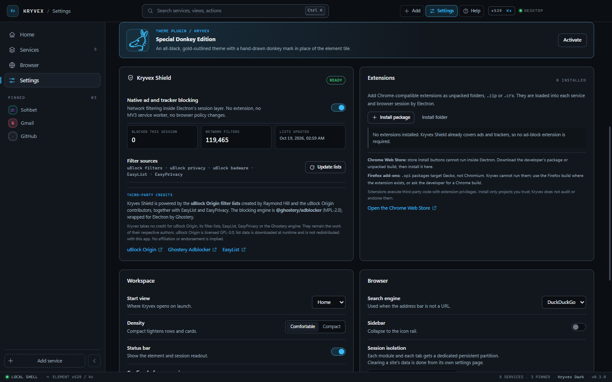
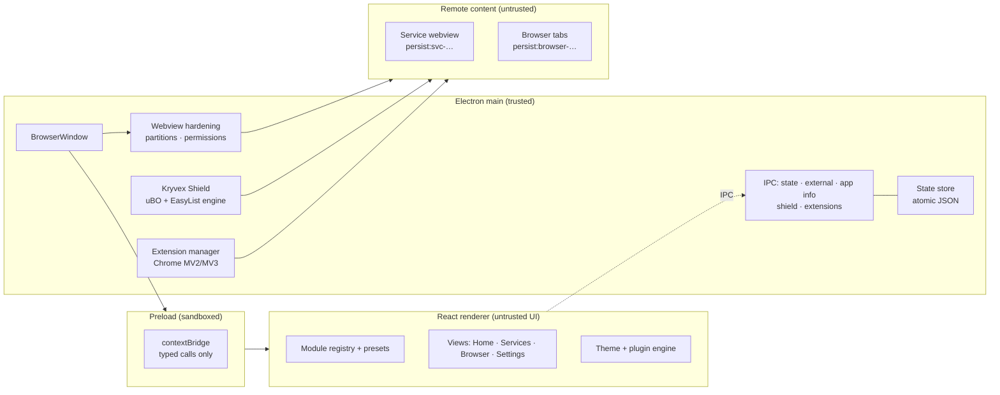

<div align="center">


### A modular desktop workspace for the web apps you actually live in.

Kryvex turns independent services into first-class modules — each with its own
persistent session, a place in your sidebar, and one keyboard-first surface.
It also ships a native ad blocker and a Chrome-extension loader, without asking
you to trust a browser policy.

[](LICENSE)
[](https://www.electronjs.org/)
[](https://react.dev/)
[](#known-limitations)
[](#kryvex-shield)

**[Install on Windows](#install-on-windows) · [No keyboard required](#no-keyboard-required) · [Features](#features) · [Screenshots](#screenshots) · [Adding services](#adding-services) · [Shield](#kryvex-shield) · [Extensions](#extensions) · [Themes](#themes) · [Credits](#credits) · [Limitations](#known-limitations)**

</div>

---


Home keeps the everyday actions in view: Add, browse services, open the
browser, or jump into settings — all ordinary buttons.

## Why Kryvex

Every team has the same stack of tabs: chat, mail, issues, notes, docs, a
dashboard, three internal tools. Browsers treat them as pages. Kryvex treats
them as **modules** — named, categorised, pinned, isolated, and one keystroke
away.

- **Modules, not tabs.** Add any web app by URL or pick a preset. Give it a
  name, category and colour. It gets a permanent tile, an isolated persistent
  session, and a place in your workspace.
- **No sign-in roulette.** Each service and each browser tab runs in its own
  Chromium partition (`persist:svc-*`, `persist:browser-*`). Clearing one never
  touches another.
- **Ads filtered natively.** Kryvex Shield runs uBlock Origin and EasyList
  filter data through Electron's own session layer. No MV3 service worker, no
  extension page, no browser-store dependency.
- **Your extensions, if you want them.** Drop in a Chrome-compatible `.zip`,
  `.crx` or unpacked folder. It is copied into Kryvex's user-data folder and
  loaded into each session.
- **Clickable by design.** Add, Settings and Help stay visible in the header,
  and Home puts the four most common actions in one strip. No shortcut
  required.
- **Keyboard when you want it.** `Ctrl K` opens the command palette for every
  view, service, action and theme. `Ctrl 1–4` jumps between Home, Services,
  Browser and Settings.
- **Local by design.** One JSON state file on your machine. No account, no
  telemetry, no cloud sync, no analytics SDK.
- **A real design system.** Seven themes (six core + one plugin), density
  modes, brand tokens, visible focus rings, reduced-motion support, and a
  periodic-table identity built from one vector tile.

> Status: **working desktop prototype (0.3.0)**. The app boots, modules load,
> sessions persist, themes switch, the shield blocks tracker requests, and the
> Windows installer and portable build run. Builds are unsigned; no
> auto-update yet.

## Install on Windows

Kryvex targets Windows 10/11 x64. `pnpm run package:win` writes two artifacts
to `release/`:

| Artifact | Use |
| --- | --- |
| `Kryvex-Setup-0.3.0-x64.exe` | Standard per-user installer. Choose the destination folder, get Desktop and Start Menu shortcuts, and uninstall from Windows Settings. |
| `Kryvex-Portable-0.3.0-x64.exe` | Run directly without installing. State still lives in `%APPDATA%\kryvex`. |

Download both files and the checksum list from the
[GitHub Releases page](https://github.com/XiONDiGiTaL/Kryvex/releases/latest).

The setup is not click-through: it opens a normal Windows wizard, lets you
pick the install location, and can launch Kryvex when it finishes. The default
per-user install needs no administrator rights; choosing a protected folder
will ask for elevation. It creates Desktop and Start Menu shortcuts and an
uninstall entry in Windows Settings.

The Setup release was installed to a custom directory, launched from that
install, and uninstalled cleanly. The Portable EXE was launched directly. Both
completed all thirteen capture routes. Artifact checksums,
verification steps and limitations are recorded in
[docs/RELEASE_0.3.0.md](docs/RELEASE_0.3.0.md).

**Unsigned build notice.** Code signing is not configured yet, so Windows
SmartScreen may show **Unknown publisher**. Only continue if you built the
artifact yourself or downloaded it from a release you trust.

## What's new in 0.3.0

- **Visible controls:** Add, Settings and Help buttons in the header, plus a
  Common actions strip on Home — search, categories, browser and preferences
  are reachable without a single keyboard shortcut.
- **Quick help:** a clickable guide for adding a service, browsing modules,
  opening the browser, opening settings, and the optional key combinations.
- **About credits:** XiONDiGiTaL and player529 are linked under **DEVELOPERS**,
  and the element reads **x529** throughout the app and brand assets.
- **Windows release:** separate named Setup and Portable EXEs, a selectable
  install folder, Desktop/Start Menu shortcuts, and an uninstaller.

## No keyboard required

Keyboard commands are optional accelerators, not the only path. Everything is
available as a button:

- **Header:** **Add**, **Settings** and **Help** are always visible.
- **Home:** four large **Common actions** cards cover add, browse, browser and
  settings.
- **Sidebar:** Home, Services, Browser and Settings are one click away at all
  times.
- **Help dialog:** four clickable actions plus a plain-language shortcut
  reference for anyone who wants it.
- **In context:** service cards open on click, settings use switches and
  dropdowns, and dialogs have visible Save/Cancel/Close buttons.

## Features

| Area | What works today |
| --- | --- |
| **Module registry** | Add, edit, remove and pin services. Name, URL, category, colour, glyph and brand-icon validation. Search, category filters, recents, starter catalogue, duplicate-safe IDs. |
| **Service catalogue** | Fifteen presets — Instagram, Telegram, WhatsApp, Discord, Messenger, Gmail, GitHub, Linear, Notion, Figma, Trello, Spotify, YouTube, Reddit and X — with brand marks and honest notes about embedding limits. |
| **Brand icons** | Built-in CC0 Simple Icons paths for known services. Unknown services request their own `/favicon.ico` directly, then fall back to a letter tile. No third-party favicon service. |
| **Isolated sessions** | One persistent partition per service and per browser tab. Cookies, storage and sign-in stay inside the module. |
| **Service workspace** | Live webview with reload, open externally, edit, remove, loading bar, and an error state with retry when a page refuses to load. |
| **Browser** | Tabs, back / forward / reload, address bar with host-or-search resolution, bookmarks bar, per-tab session, system-browser handoff. |
| **Kryvex Shield** | Native network filtering from uBlock Origin filters, uBO Privacy/Badware, EasyList and EasyPrivacy. Live blocked counter, filter count, update-now, cached engine, per-session attachment. No MV3. |
| **Extensions** | Install Chrome-compatible extensions from `.zip`, `.crx` or a folder; enable, disable, remove. Loaded into the shell, services and browser sessions. |
| **Themes** | Six core themes plus the **Special Donkey Edition** plugin (true black + gold, donkey line-art brand mark). All token-driven from `brand/themes.json` and `src/plugins/`. |
| **Layout** | Collapsible sidebar (rail ↔ expanded), comfortable/compact density, toggleable status bar, adjustable start view. |
| **Usability** | Header Add / Settings / Help buttons, Home common-action cards, a clickable quick-help dialog, visible dialog buttons, and optional keyboard shortcuts. |
| **Command palette** | Fuzzy-ish filter over navigation, actions, services and themes; arrow keys, `Enter`, `Esc`. Optional — every action also has a visible button. |
| **Persistence** | Debounced writes with an atomic temp-file rename, 1 MB cap, defensive sanitisation on every load. Reset restores starters. |
| **Security** | Sandboxed renderer, context isolation, fixed IPC bridge, sender checks on privileged calls, hardened webviews, partition allowlist, http(s)-only navigation, denied permissions, externalised popups. |
| **Quality** | 40 unit tests, strict TypeScript across renderer and main, production build, packaged-app run, real screenshots from the running window. |

## Screenshots

All captures below come from the running Electron window at 1440×900, produced
by the app's own capture routine — no mockups.

### Help — no keyboard required


The Help button opens a clickable guide, not a keyboard cheat sheet. Shortcut
commands are listed separately as optional accelerators.

### Services — the module registry


Cards carry the module colour, category, host, pin state and inline actions.
Filter chips double as a quick inventory of how your workspace is composed.

### Adding a service from the catalogue


Pick Instagram, Telegram, WhatsApp or another preset, or enter any URL. URLs
are normalised (`linear.app` → `https://linear.app`), restricted to http(s),
and validated before a module is created.

### A service running in its own session


The module fills the workspace while the shell keeps identity, session state
and controls. Closing Kryvex and reopening it later keeps the session alive.

### Browser


A real Chromium workspace: tabs, history navigation, address bar, bookmarks,
and a start page that surfaces your modules. Each tab is a separate persistent
session.

### Command palette


`Ctrl K` reaches anything: views, add-service, every module, and theme
switching — without leaving the keyboard. You never need it: the same actions
are available through the header, Home cards, sidebar and Help dialog.

### Kryvex Shield and extensions


The shield reports its state, filter count, blocked requests this session, list
sources and last update. Next to it, Chrome-compatible extensions can be
installed, toggled or removed. The credit block names uBlock Origin, Ghostery
and EasyList explicitly.

### Theme plugin — Special Donkey Edition




A self-contained plugin: true-black surfaces, gold line work, and a donkey mark
in place of the element tile. It is still a normal token theme, so every
surface, focus ring and chart follows it.

### Settings and themes


Theme, density, start view, search engine, sidebar behaviour, reset and runtime
details. The About panel reports the actual Electron/Chromium versions from the
running app, the `x529` element designation, and linked developer credits for
XiONDiGiTaL and player529.

### Light theme


The same tokens, contrast-checked for light surfaces: darker accents, readable
metadata, and the graphite element tile preserved as the brand anchor.

## Adding services

1. Press `Ctrl K` and choose **Add a service**, click **Add service** in the
   header, or use the dashed button at the bottom of the sidebar.
2. Pick a catalogue preset or enter a name, URL, category and colour.
3. Save. Kryvex normalises the URL, assigns a partition
   (`persist:svc-<id>`), adds the module to the registry, and puts it in the
   sidebar if pinned.

```jsonc
// What a module looks like inside kryvex-state.json
{
  "id": "s-2f5c...",              // validated, URL-safe, used for the partition
  "name": "Instagram",
  "url": "https://www.instagram.com",
  "category": "communication",    // communication | productivity | development | media | other
  "color": "#FB7185",             // one of the eight brand-safe accents
  "letter": "I",
  "icon": "instagram",            // optional known-brand glyph
  "pinned": true,
  "createdAt": 1760000000000,
  "lastOpened": 1760000009999
}
```

Modules are data only. A module cannot execute code in the shell, register
hooks, or access another module's session. The registry rejects duplicate IDs,
unsafe IDs, non-http(s) URLs, unknown categories, off-palette colours and
unknown icon keys before anything is written. See [docs/APP.md](docs/APP.md)
for the manifest contract and lifecycle.

### Presets are links, not integrations

The catalogue contains public web endpoints. Instagram, WhatsApp, Telegram and
the rest still run their own code, enforce their own login flows and may refuse
to work inside any embedded browser. Kryvex offers **Open externally** rather
than weakening the session. There is no unofficial API, scraper or credential
collection in this project.

## Kryvex Shield

Kryvex Shield is a native filter engine attached to Electron sessions. It is
enabled by default, downloads its lists once, caches a compiled engine in the
user-data directory, and refreshes after seven days.

- **Filter sources:** uBlock Origin `filters`, `privacy` and `badware` lists,
  plus EasyList and EasyPrivacy.
- **Engine:** `@ghostery/adblocker` with its Electron `webRequest` adapter.
- **Scope:** the shell, every `persist:svc-*` module session, and every
  `persist:browser-*` tab session.
- **State:** toggle, update-now, filter count, last update and a session
  blocked counter in Settings.
- **No MV3:** no extension service worker, no `declarativeNetRequest`, no
  Chrome Web Store install, no manifest permissions.

### Why not ship the uBlock Origin extension?

uBlock Origin classic is Manifest V2. Electron 44 loads the extension package,
but its blocking `webRequest` layer is inert and its dashboard never finishes
initialising. Shipping it would be a decorative toggle that blocks nothing.
Kryvex uses uBO's **filter lists** natively instead. A local shim lets the
Ghostery Electron adapter share its cosmetic-filter IPC handlers across many
isolated sessions (the upstream adapter assumes one session per process).

Verification: a service partition loaded a page requesting
`facebook.com/tr` and `connect.facebook.net`; with the shield on, the engine
reported 2 blocked requests and those requests failed with
`net::ERR_BLOCKED_BY_CLIENT`. With it off, they completed. The packaged
`release/win-unpacked/Kryvex.exe` reports 119,465 network filters from the
cached engine.

## Extensions

Settings → Extensions loads Chrome-compatible extensions:

- **Install package:** `.zip` or `.crx` (CRX3 headers are stripped to the ZIP
  payload). **Install folder:** an unpacked extension directory.
- Kryvex copies the extension into `userData/extensions/<key>`, validates
  `manifest.json` and Manifest V2/V3, and loads it with Electron's
  `session.extensions` API.
- Each installed extension can be enabled, disabled or removed. It is loaded
  into existing sessions and attached to new service/browser partitions as they
  appear.
- Tested with a minimal MV3 content-script extension: it loaded in a
  `persist:svc-*` partition and modified the page.

**Chrome Web Store:** the store's install button cannot run inside Electron.
Download the developer's package/unpacked build and install it here. Kryvex
does not scrape the store or auto-install arbitrary store listings.

**Firefox add-ons:** `.xpi` files target Gecko, not Chromium. Electron cannot
run them, so Kryvex rejects them with a clear message instead of pretending.
Use a Chrome build of the add-on when one exists.

Extensions execute third-party code with extension privileges. Install only
projects you trust. Kryvex does not audit or endorse them.

## Themes

Six core themes live in [`brand/themes.json`](brand/themes.json); the seventh
is a plugin:

| Theme | Mode | Character |
| --- | --- | --- |
| **Kryvex Dark** | dark | Default. Graphite surfaces, electric blue + teal accents. |
| **Kryvex Light** | light | Same tokens, darker accents for contrast on white. |
| **Midnight** | dark | Deep navy, cooler accents. |
| **Graphite** | dark | Neutral industrial greys. |
| **OLED Black** | dark | True black for OLED panels. |
| **High Contrast** | dark | White borders, maximum legibility. |
| **Special Donkey Edition** | dark | Plugin. True black, gold outlines, donkey brand mark. |

[`brand/tokens.json`](brand/tokens.json) is the single source of truth for
colour, spacing, radii, typography, motion and shell metrics. Themes apply CSS
custom properties at runtime; there is no second palette to drift.

### Writing a theme plugin

`src/plugins/donkey.tsx` is the reference implementation: a theme object with
`plugin: true`, a `mark` hint, and any marks the theme wants. Register it in
`src/plugins/index.ts`; the theme grid, command palette and persistence pick it
up automatically. Plugin themes are validated by the same `isThemeId` path as
core themes, so a bad import cannot poison saved state.

## Architecture

Kryvex is a fresh implementation (it does not ship a Ferdium fork) built around
a small trusted main process and untrusted content:



- **Main** owns the window, state file, filter engine, extension folders and
  every security decision.
- **Preload** exposes typed calls only — state, external links, app info,
  shield status/control, extension list/install/toggle/remove. No filesystem,
  shell, arbitrary IPC or extension path crosses the bridge.
- **Renderer** owns UI and validation. It has no filesystem or shell access.
- **Remote content** runs in hardened webviews: no preload, no Node, sandboxed,
  isolated partitions, http(s)-only navigation, popups sent to the system
  browser, and permissions denied except clipboard writes and fullscreen.

### Project structure

```text
electron/
  main.ts              window, state store, capture routine, IPC registration
  preload.ts           contextBridge API
  shield.ts            native uBO/EasyList engine, cache, session attachment
  extensions.ts        Chrome package installer + per-session loader
  types.ts             main-process IPC payload types
src/
  App.tsx              shell, routing, state, palette, dialogs, toasts
  components/          shell chrome, service dialog, palette, webview, UI
  views/               Home, Services, ServiceView, Browser, Settings
  lib/                 store, services, catalogue, brand icons, themes, storage
  plugins/             Special Donkey Edition theme + mark
  styles.css           all UI styling, token-driven
brand/                 logo + variants, icons, tokens.json, themes.json
docs/                  architecture, security, attribution, testing, banner
tests/                 unit tests (vitest)
screenshots/           captures produced by the running app
scripts/               dev + capture helpers
```

## Getting started

**Requirements:** Node 24+, pnpm 12+, Windows 10/11 for the packaged app.
Verified with Node 24.19.0, pnpm 12.3.4, Electron 44.2.0.

```bash
# 1. install (downloads the Electron runtime)
pnpm install

# 2. develop with hot reload — starts Vite and the Electron shell
pnpm dev:electron

# web-only preview of the UI (no webviews)
pnpm dev

# 3. verify
pnpm typecheck     # renderer + main, strict
pnpm test          # 40 unit tests

# 4. production build
pnpm build         # dist/ (renderer) + dist-electron/ (main + preload)
pnpm start         # run the built app
```

### Scripts

| Script | Purpose |
| --- | --- |
| `pnpm dev` | Vite dev server for the renderer (`http://127.0.0.1:5173`). Webviews show a fallback panel. |
| `pnpm dev:electron` | Vite + Electron with hot reload. |
| `pnpm build` | Renderer bundle + compiled main/preload. |
| `pnpm start` | Launch the built app. |
| `pnpm typecheck` | `tsc --noEmit` for both projects. |
| `pnpm test` | Vitest unit suite. |
| `pnpm capture` | Rebuild and regenerate `screenshots/` from the running app. |
| `pnpm run package:dir` | electron-builder unpacked Windows directory (`release/win-unpacked`). |
| `pnpm run package:win` | electron-builder installer/portable targets (unsigned). |

`pnpm pack` is pnpm's own tarball command, not the packaging script — use
`pnpm run package:*`.

### Packaging

`package.json` contains the electron-builder configuration: app id
`net.xiondigital.kryvex`, NSIS + portable Windows targets, the 7-resolution
`brand/icons/kryvex.ico`, extra icons in resources, and production node modules
for the shield/extension runtime. Code signing is not configured, so current
builds are unsigned development artifacts.

`pnpm run package:win` writes distinct artifacts: a standard Setup EXE with a
selectable install folder, Desktop/Start Menu shortcuts and an uninstaller; and
a Portable EXE for no-install use. The unpacked build remains at
`release/win-unpacked/` (not committed). All artifacts stay out of Git via
`.gitignore`.

## Data and privacy

- State lives in Electron's `userData` directory as `kryvex-state.json`; the
  web preview uses `localStorage` instead.
- Writes are debounced (250 ms), capped at 1 MB, and atomic (temp file +
  rename). A corrupt or hostile state file is sanitised, never trusted.
- Shield configuration lives in `kryvex-shield.json`; the compiled engine is
  `kryvex-shield-engine.bin` (about 6 MB). Both stay on this machine.
- Installed extensions live in `userData/extensions/<key>` with metadata in
  `kryvex-extensions.json`.
- Kryvex has no backend, account system, telemetry or remote config. Network
  traffic is only what your own modules load, plus the first-run/7-day filter
  list download from `ublockorigin.github.io` and `easylist.to`.
- `openExternal` and popup handling accept http(s) only.
- Unknown service favicons are requested from the service's own origin, not a
  favicon CDN.

## Security model

| Control | Implementation |
| --- | --- |
| Renderer isolation | `contextIsolation: true`, `nodeIntegration: false`, `sandbox: true` |
| Bridge surface | Fixed typed IPC calls; shell-sender checks on shield and extension mutations |
| Remote content | Webviews attach without preload; Node, web security and insecure content forced off |
| Sessions | Partition allowlist (`persist:svc-*`, `persist:browser-*`) enforced in `will-attach-webview` |
| Navigation | Non-http(s) URLs blocked in webviews; shell cannot navigate away from the app |
| Popups | Denied in-app, forwarded to the system browser after protocol validation |
| Permissions | All denied except `clipboard-sanitized-write` and `fullscreen` |
| Shield | Local lists only, no remote rules at request time, no TLS bypass |
| Extensions | Copied under `userData/extensions`; manifest and size validated; removal is path-checked |
| State | Structural validation, 1 MB cap, atomic write, sanitisation on load |

Known gaps are listed below rather than hidden. See
[docs/SECURITY_MODEL.md](docs/SECURITY_MODEL.md) and
[docs/ATTRIBUTION.md](docs/ATTRIBUTION.md).

## Credits

Kryvex is designed and built by [XiONDiGiTaL](https://github.com/XiONDiGiTaL)
and [player529](https://github.com/player529).

Kryvex takes **no credit** for the following work:

- **uBlock Origin** — filter lists by Raymond Hill and contributors
  ([gorhill/uBlock](https://github.com/gorhill/uBlock), GPL-3.0). Kryvex
  downloads the lists at runtime and does not ship uBO code or claim
  affiliation.
- **Ghostery Adblocker** — the filtering engine
  ([ghostery/adblocker](https://github.com/ghostery/adblocker), MPL-2.0).
- **EasyList / EasyPrivacy** — list maintainers
  ([easylist.to](https://easylist.to/), GPL-3.0).
- **Simple Icons** — CC0 brand glyph paths
  ([simpleicons.org](https://simpleicons.org)); trademarks belong to their
  owners and identify the linked services only.

The full license and modification notes are in
[docs/ATTRIBUTION.md](docs/ATTRIBUTION.md).

## Known limitations

- **Windows first.** The app runs on Electron and should work on macOS/Linux,
  but only Windows has been exercised here; packaging is Windows-only.
- **Unsigned installer and no auto-update yet.** `pnpm run package:win`
  produces Setup and Portable EXEs; code signing and update feeds are roadmap
  work.
- **Shield is list-based network filtering.** It is not the full uBlock Origin
  extension: no uBO dashboard, no per-site dynamic rules, and cosmetic
  filtering depends on the upstream engine. uBO classic's MV2 network layer
  does not work in Electron 44, which is why this is native.
- **Chrome extensions only.** Firefox `.xpi` add-ons cannot run; the Chrome Web
  Store cannot be installed from inside Electron. Extensions are
  third-party code and are not audited.
- **Some services resist embedding.** Popups, strict SSO flows, or sites that
  reject the Electron user agent may not work inside a module. Kryvex offers
  "Open externally" instead of weakening security.
- **Browser is intentionally lean.** Tabs, history navigation and bookmarks are
  implemented; there is no downloads manager, history browser, find-in-page UI
  or extension store UI yet.
- **Theme Studio is roadmap.** Themes are built-in/plugin-based; importing and
  exporting arbitrary themes is not implemented.
- **No sync.** State is local to the machine. There is no account, backup or
  multi-device sync.
- **Brand naming is provisional.** "Kryvex" is a working name; formal name
  clearance has not been completed.

## Roadmap

- Shield depth: per-site exceptions, custom filters, cosmetic-filter
  verification and a blocked-request inspector.
- Extension UX: drag-and-drop install, update checks and clearer MV2/MV3
  compatibility warnings.
- Theme Studio: custom accent, radius, density and import/export with schema
  validation.
- Hibernation: suspend idle modules to reclaim memory, with explicit states.
- Browser depth: download shelf, history, find-in-page, zoom controls.
- Packaging: signed Windows builds and a CI matrix.
- macOS/Linux validation and platform icon sets.

## License

Code and brand assets are released under the [MIT License](LICENSE).
Kryvex is an independent project; "element x529 / Kx" is a fictional brand
device, not a claim about a chemical element. Third-party data and libraries
retain their own licenses — see [docs/ATTRIBUTION.md](docs/ATTRIBUTION.md).

<div align="center"><sub>KRYVEX · ELEMENT x529 · SHIELD · EXTENSIONS · DONKEY EDITION.</sub></div>
