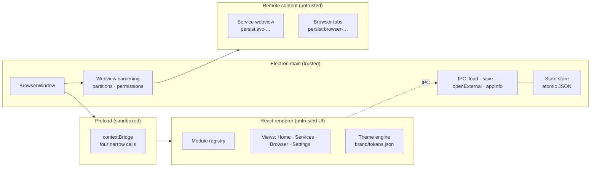

<div align="center">


### A modular desktop workspace for the web apps you actually live in.

Kryvex turns independent services into first-class modules — each with its own
persistent session, a place in your sidebar, and one keyboard-first surface.

[](LICENSE)
[](https://www.electronjs.org/)
[](https://react.dev/)
[](#known-limitations)

**[Features](#features) · [Screenshots](#screenshots) · [Adding services](#adding-a-service) · [Themes](#themes) · [Architecture](#architecture) · [Getting started](#getting-started) · [Limitations](#known-limitations)**

</div>

---


## Why Kryvex

Every team has the same stack of tabs: chat, mail, issues, notes, docs, a
dashboard, three internal tools. Browsers treat them as pages. Kryvex treats
them as **modules** — named, categorised, pinned, isolated, and one keystroke
away.

- **Modules, not tabs.** Add any web app by URL. Give it a name, category and
  colour. It gets a permanent tile, an isolated persistent session, and a place
  in your workspace.
- **No sign-in roulette.** Each service and each browser tab runs in its own
  Chromium partition (`persist:svc-*`, `persist:browser-*`). Clearing one never
  touches another.
- **Keyboard first.** `Ctrl K` opens the command palette for every view,
  service, action and theme. `Ctrl 1–4` jumps between Home, Services, Browser
  and Settings.
- **Local by design.** One JSON state file on your machine. No account, no
  telemetry, no cloud sync, no analytics SDK.
- **A real design system.** Six themes, density modes, brand tokens, visible
  focus rings, reduced-motion support, and a periodic-table identity built from
  one vector tile.

> Status: **working desktop prototype (0.1.0)**. The app boots, modules load,
> sessions persist, themes switch, and the state survives restarts. Packaging
> config exists; signed installers are not part of this release.

## Features

| Area | What works today |
| --- | --- |
| **Module registry** | Add, edit, remove and pin services. Name, URL, category, colour and glyph validation. Filter by category, search by name or host, recents, starter catalogue, duplicate-safe IDs. |
| **Isolated sessions** | One persistent partition per service and per browser tab. Cookies, storage and sign-in stay inside the module. |
| **Service workspace** | Live webview with reload, open externally, edit, remove, loading bar, and a real error state with retry when a page refuses to load. |
| **Browser** | Tabs (create, switch, close), back / forward / reload, address bar with host-or-search resolution, bookmarks bar, bookmark toggle, per-tab session, system-browser handoff. |
| **Themes** | Six built-in themes, including a light theme, OLED black and a high-contrast mode. Applied from `brand/themes.json` at runtime — not duplicated in CSS. |
| **Layout** | Collapsible sidebar (rail ↔ expanded), comfortable/compact density, toggleable status bar, adjustable start view. |
| **Command palette** | Fuzzy-ish filter over navigation, actions, services and themes; arrow keys, `Enter`, `Esc`. |
| **Persistence** | Debounced writes with an atomic temp-file rename, 1 MB cap, and defensive sanitisation on every load. Reset action restores the starter workspace. |
| **Security** | Sandboxed renderer, context isolation, no Node in remote content, hardened webviews, partition allowlist, http(s)-only navigation, denied permissions, externalised popups. |
| **Quality** | 38 unit tests, strict TypeScript across renderer and main, production build, real screenshots generated from the running app. |

## Screenshots

All captures below come from the running Electron window at 1440×900, produced
by the app's own capture routine — no mockups.

### Services — the module registry


Cards carry the module colour, category, host, pin state and inline actions.
Filter chips double as a quick inventory of how your workspace is composed.

### Adding a service


Name, URL, category, colour, and a pin toggle. URLs are normalised
(`linear.app` → `https://linear.app`), restricted to http(s), and validated
before a module is created.

### A service running in its own session


The module fills the workspace while the shell keeps identity, session state
and controls. Closing Kryvex and reopening it later keeps the session alive.

### Browser


A real Chromium workspace: tabs, history navigation, address bar, bookmarks,
and a start page that surfaces your modules. Each tab is a separate persistent
session.

### Command palette


`Ctrl K` reaches anything: views, add-service, every module, and theme
switching — without leaving the keyboard.

### Settings and themes


Theme, density, start view, search engine, sidebar behaviour, reset and runtime
details. The About panel reports the actual Electron/Chromium versions from the
running app.

### Light theme


The same tokens, contrast-checked for light surfaces: darker accents, readable
metadata, and the graphite element tile preserved as the brand anchor.

## Adding a service

1. Press `Ctrl K` and choose **Add a service**, click **Add service** in the
   header, or use the dashed button at the bottom of the sidebar.
2. Enter a name, a URL, a category, a colour, and whether it should be pinned.
3. Save. Kryvex normalises the URL, assigns a partition
   (`persist:svc-<id>`), adds the module to the registry, and puts it in the
   sidebar if pinned.

```jsonc
// What a module looks like inside kryvex-state.json
{
  "id": "s-2f5c...",              // validated, URL-safe, used for the partition
  "name": "Linear",
  "url": "https://linear.app",
  "category": "productivity",     // communication | productivity | development | media | other
  "color": "#38BDF8",             // one of the eight brand-safe accents
  "letter": "L",
  "pinned": true,
  "createdAt": 1760000000000,
  "lastOpened": 1760000009999
}
```

Modules are data only. A module cannot execute code in the shell, register
hooks, or access another module's session. The registry rejects duplicate IDs,
unsafe IDs, non-http(s) URLs, unknown categories and off-palette colours before
anything is written. See [docs/APP.md](docs/APP.md) for the full manifest
contract and lifecycle.

## Themes

Six themes ship in [`brand/themes.json`](brand/themes.json) and are applied as
CSS custom properties at runtime:

| Theme | Mode | Character |
| --- | --- | --- |
| **Kryvex Dark** | dark | Default. Graphite surfaces, electric blue + teal accents. |
| **Kryvex Light** | light | Same tokens, darker accents for contrast on white. |
| **Midnight** | dark | Deep navy, cooler accents. |
| **Graphite** | dark | Neutral industrial greys. |
| **OLED Black** | dark | True black for OLED panels. |
| **High Contrast** | dark | White borders, maximum legibility. |

[`brand/tokens.json`](brand/tokens.json) is the single source of truth for
colour, spacing, radii, typography, motion and shell metrics. The renderer
imports it directly; there is no second palette to drift.

## Architecture

Kryvex is a fresh implementation (it does not ship a Ferdium fork) built around
a three-layer contract:



- **Main** owns the window, the state file and every security decision.
- **Preload** exposes exactly four calls — load state, save state, open an
  external URL, read app info. Nothing else crosses the bridge.
- **Renderer** owns UI and validation. It has no filesystem or shell access.
- **Remote content** runs in hardened webviews: no preload, no Node, sandboxed,
  isolated partitions, http(s)-only navigation, popups sent to the system
  browser, and permissions denied except clipboard writes and fullscreen.

### Project structure

```text
electron/
  main.ts              window, state store, webview hardening, capture routine
  preload.ts           contextBridge API (four calls)
src/
  App.tsx              shell, routing, state, palette, dialogs, toasts
  components/          shell chrome, service dialog, command palette, webview, UI primitives
  views/               Home, Services, ServiceView, Browser, Settings
  lib/                 store (pure), services, url, themes, storage
  styles.css           all UI styling, token-driven
brand/                 logo + variants, icons, tokens.json, themes.json, BRAND.md
docs/                  brand spec, architecture, security, banner
tests/                 unit tests (vitest)
screenshots/           captures produced by the running app
scripts/               dev + capture helpers
```

## Getting started

**Requirements:** Node 24+, pnpm 12+, Windows 10/11 for the packaged app.
Verified with Node 24.19.0, pnpm 12.3.4, Electron 44.2.0.

```bash
# 1. install (downloads the Electron runtime)
pnpm install

# 2. develop with hot reload — starts Vite and the Electron shell
pnpm dev:electron

# web-only preview of the UI (no webviews)
pnpm dev

# 3. verify
pnpm typecheck     # renderer + main, strict
pnpm test          # 38 unit tests

# 4. production build
pnpm build         # dist/ (renderer) + dist-electron/ (main + preload)
pnpm start         # run the built app
```

### Scripts

| Script | Purpose |
| --- | --- |
| `pnpm dev` | Vite dev server for the renderer (`http://127.0.0.1:5173`). Webviews show a fallback panel. |
| `pnpm dev:electron` | Vite + Electron with hot reload. |
| `pnpm build` | Renderer bundle + compiled main/preload. |
| `pnpm start` | Launch the built app. |
| `pnpm typecheck` | `tsc --noEmit` for both projects. |
| `pnpm test` | Vitest unit suite. |
| `pnpm capture` | Rebuild and regenerate `screenshots/` from the running app. |
| `pnpm pack` / `pnpm dist` | electron-builder unpacked dir / installer (unsigned, Windows targets configured). |

### Packaging

`package.json` contains the electron-builder configuration: app id
`net.xiondigital.kryvex`, NSIS + portable Windows targets, the 7-resolution
`brand/icons/kryvex.ico`, and only built output in the package. Code signing is
not configured, so current builds are unsigned development artifacts.

## Data and privacy

- State lives in Electron's `userData` directory as `kryvex-state.json`; the
  web preview uses `localStorage` instead.
- Writes are debounced (250 ms), capped at 1 MB, and atomic (temp file +
  rename). A corrupt or hostile state file is sanitised, never trusted.
- Kryvex has no backend, account system, telemetry or remote config. Network
  traffic is only what your own modules load.
- `openExternal` and popup handling accept http(s) only.

## Security model

| Control | Implementation |
| --- | --- |
| Renderer isolation | `contextIsolation: true`, `nodeIntegration: false`, `sandbox: true` |
| Bridge surface | Four IPC calls, arguments validated in main |
| Remote content | Webviews attach without preload; Node, web security and insecure content forced off |
| Sessions | Partition allowlist (`persist:svc-*`, `persist:browser-*`) enforced in `will-attach-webview` |
| Navigation | Non-http(s) URLs blocked in webviews; shell cannot navigate away from the app |
| Popups | Denied in-app, forwarded to the system browser after protocol validation |
| Permissions | All denied except `clipboard-sanitized-write` and `fullscreen` |
| State | Structural validation, 1 MB cap, atomic write, sanitisation on load |

Known gaps are listed below rather than hidden. See
[docs/SECURITY_MODEL.md](docs/SECURITY_MODEL.md).

## Known limitations

- **Windows first.** The app runs on Electron and should work on macOS/Linux,
  but only Windows has been exercised here; packaging is Windows-only.
- **No signed installer or auto-update yet.** `pnpm dist` produces an unsigned
  installer; release signing and update feeds are roadmap work.
- **Some services resist embedding.** Popups, strict SSO flows, or sites that
  reject the Electron user agent may not work inside a module. Kryvex offers
  "Open externally" instead of weakening security. Iframe/frame policies do not
  apply to webviews, but a site can still fail for other reasons.
- **Browser is intentionally lean.** Tabs, history navigation and bookmarks are
  implemented; there is no downloads manager, history browser, find-in-page UI
  or extension support yet.
- **Theme Studio is roadmap.** Themes are built-in and token-driven; importing
  and exporting custom themes is not implemented.
- **No sync.** State is local to the machine. There is no account, backup or
  multi-device sync.
- **Brand naming is provisional.** "Kryvex" is a working name; formal name
  clearance has not been completed.

## Roadmap

- Theme Studio: custom accent, radius, density and import/export with schema
  validation.
- Hibernation: suspend idle modules to reclaim memory, with explicit states.
- Browser depth: download shelf, history, find-in-page, zoom controls.
- Module lifecycle: per-module permissions, health checks and crash isolation.
- Packaging: signed Windows builds, portable build, CI matrix.
- macOS/Linux validation and platform icon sets.

## License

Code and brand assets are released under the [MIT License](LICENSE).
Kryvex is an independent project; "element 027 / Kx" is a fictional brand
device, not a claim about a chemical element.

<div align="center"><sub>KRYVEX · ELEMENT 027 · PRECISION IN EVERY CONNECTION.</sub></div>
