<div align="center">

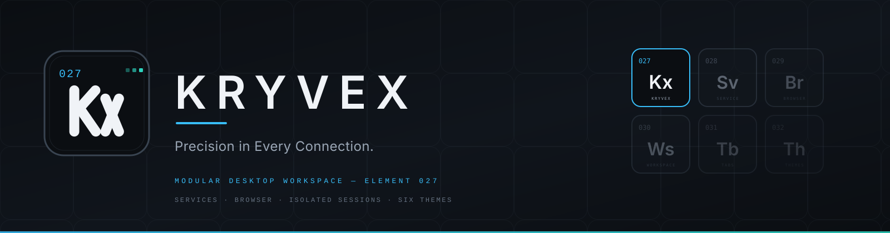

# Kryvex

**Every web app you actually live in, turned into one engineered desktop.**

Not another browser with bookmarks. Kryvex makes Discord, Gmail, Linear, Notion,
your dashboard and your internal tools into first-class modules — each with its
own persistent session, its own place in the workspace, and none of the tab
roulette that eats your day.

[](https://github.com/XiONDiGiTaL/Kryvex/releases/latest)
[](https://github.com/XiONDiGiTaL/Kryvex/releases)
[](#install-on-windows)
[](LICENSE)
[](https://xiondigital.net/Kryvex/)
[](https://github.com/XiONDiGiTaL/Kryvex/stargazers)

**[Download](#install-on-windows) · [What it does](#what-kryvex-gives-you) · [A look inside](#a-look-inside) · [Themes](#the-workspace-looks-like-you) · [Privacy](#privacy-by-construction) · [Documentation](#documentation)**

</div>

---

## Tabs were never a workspace

A browser treats every app you use as a page. So the chat you keep open all day
gets reloaded by a stray click, the session you signed into on Monday is gone by
Tuesday, and five tools that belong to one job sit in five unrelated tabs with
five unrelated logins.

Kryvex takes the opposite position: your apps are **modules**. A module is
named, categorised, coloured, pinnable, isolated, and always one keystroke or one
click away. It stays mounted while you work somewhere else, so a call keeps its
connection and a download keeps its progress. That single change is the whole
product: the workspace stops being a list of pages and starts being your actual
desk.

Twenty seconds inside the real app:

[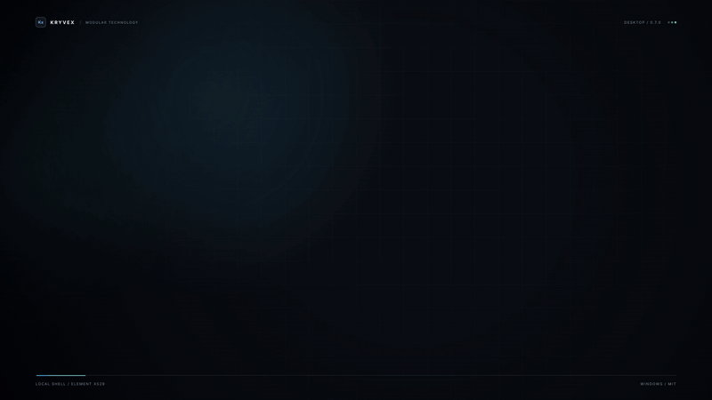](docs/media/kryvex-demo.mp4)

**[Open the full reel](docs/media/kryvex-demo.mp4)** — 1920×1080, with sound. The
preview above is the same cut, lighter, so it plays inline like an image.

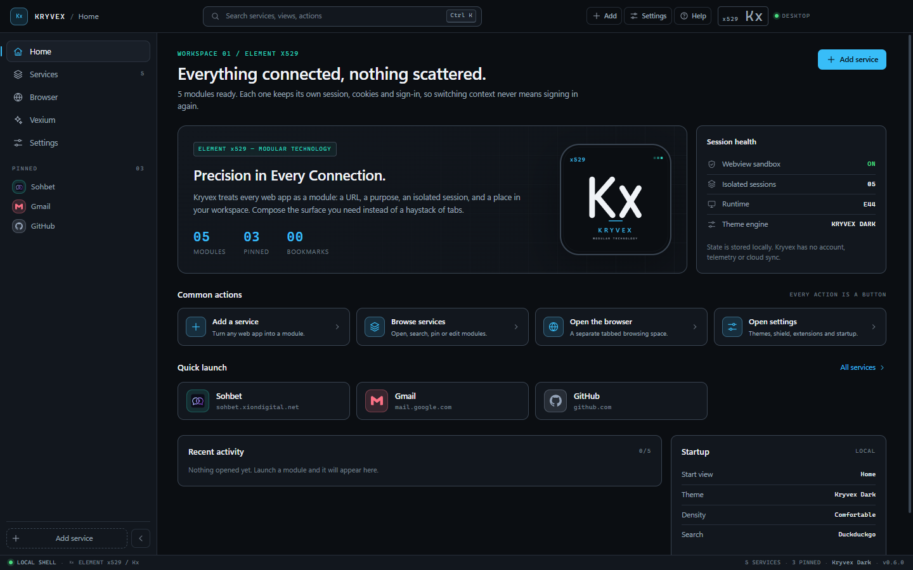

Home keeps the everyday moves where you can see them: add a service, browse the
catalogue, open the browser, jump into settings. No hidden shortcut sheet
required.

## What Kryvex gives you

### Your apps, as installed things

Pick a preset from **180 services across 16 categories** — Discord, Steam,
Gmail, Slack-shaped internal tools, Linear, Notion, Figma, Spotify, YouTube,
GitHub, ChatGPT, banking, travel, news desks — or point Kryvex at any URL.
Each module gets a permanent tile, an isolated Chromium partition
(`persist:svc-*`), native notifications, an unread badge in the taskbar, and a
sandboxed sign-in window that finishes OAuth inside Kryvex instead of handing you
off to another browser and losing the callback.

Sessions survive restarts. Sign into a service in the morning, quit, reopen in
the evening: still signed in, still where you left it.

### A browser that is actually yours

The built-in browser is Chromium with a memory: tabs and the active tab come
back after a restart, alongside searchable history, bookmarks, live download
progress, find-in-page, per-tab zoom, and a designed start page instead of a
blank void. Private tabs open on `Ctrl+Shift+N`, carry the mask in the tab
strip, write no history, and are never restored — closing them wipes their
partitions.

Magnet links and `.torrent` files open in the same downloads hub, with live
seeders, ratio and file lists. Kryvex is a client for content you have the right
to use; it hosts, indexes and recommends nothing.

### Privacy you don't have to configure

Kryvex Shield filters at the session layer with the real uBlock Origin lists,
EasyList, EasyPrivacy and EasyList Cookie — about **121,700 filters**, cached
locally, no extension, no service worker, no store. Top-level navigations are
upgraded to HTTPS with a single honest fallback, campaign parameters like
`utm_*` and `fbclid` are stripped before the request, and canvas, WebGL and
audio readbacks get stable per-site noise so a fingerprint is less useful.
**My filters** accepts the uBO syntax people already paste, and each protection
has its own switch.

No account. No telemetry. No analytics SDK. No cloud sync. One JSON state file
on your machine, and that's the whole backend.

### Tools worth opening, built in

Five in-house tools live behind their own gated tab beside your modules:

- **Lexium** transcribes recordings with timed segments and `.srt` export,
  translates in both directions, and reads text out of images — using the speech
  engine Windows already has, or a Whisper server you run.
- **Media player** queues local files, direct links, Spotify previews and
  YouTube playlists, and keeps playing while you work in another view.
- **8-bit emulator** runs the ROMs you already own, with save states that survive
  view changes. Dreamcast is opt-in; real netplay uses the RetroArch you install
  yourself.
- **Disk pulse** draws your drive as a heart-rate trace and offers a guarded
  cleaner — typed confirmation, strict path checks, its own worker thread.
- **Kryvex Link** turns your phone into a companion over your own network:
  clipboard both ways, file transfer both ways, a remote for the player.

### Rooms, without an account

Create a room, copy one invite, and everyone who opens it lands in the same
place: presence, names, colours, ephemeral chat, and screen share of a whole
screen, a window, or one specific Kryvex app. Peers connect directly over
WebRTC; no Kryvex server sits in the media path.

### An assistant that stays on your machine

**Vexium** talks to a model runtime on loopback — the bundled llama.cpp runtime
with a reviewed Qwen2.5 model, or Ollama or LM Studio, or a `.gguf` you already
have. Prompts and replies stay in the window; nothing is written to disk. When no
model is loaded it answers app questions offline and can read three keyless
channels — a GitHub repository, a Hacker News thread, an arXiv paper — and says
so when a platform refuses.

### The workspace looks like you

**81 themes** arranged as a periodic table with two-letter symbols and palette
strips: core, spectrum, flame-test elements, metals, birthstone gems, planets,
lights, terminal, three creator editions, and a **Custom** studio with
hue/saturation fields, rainbow sliders and editable HEX/RGB. A first-run gallery
lets you compare whole families on a miniature workspace before committing.
Density modes, a collapsible rail, an optional wallpaper built from the theme's
own accent tokens, visible focus rings and reduced-motion support all ride the
same tokens.

### It speaks your language

English, Spanish, German, French and Turkish across the shell, dialogs,
settings, browser library and errors. Spanish, German and French are complete
apart from protocol tokens and words already correct in the target language;
Turkish is knowingly partial and labelled as such rather than left looking
broken. Coverage is measured by an audit that fails the build if it regresses.

## A look inside

Every capture below comes from the running app, not a mockup.

**The module registry** — colour, category, host, pin state and inline actions,
with filter chips doubling as an inventory of your workspace.

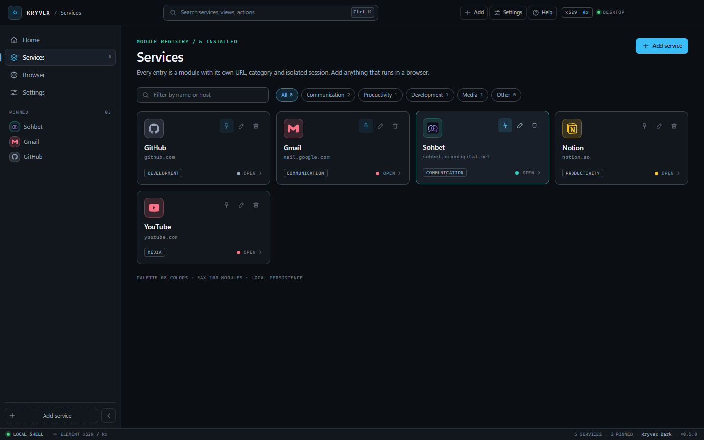

**A service in its own session** — the module fills the workspace while the
shell keeps identity, session state and controls.

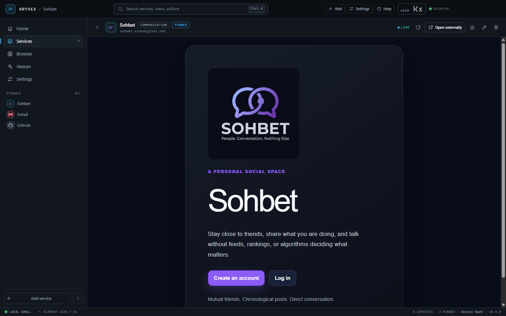

**The browser, with a start page worth landing on** — field guide, live shield
counters, quick launch and an RSS reader that takes a URL or an OPML import.

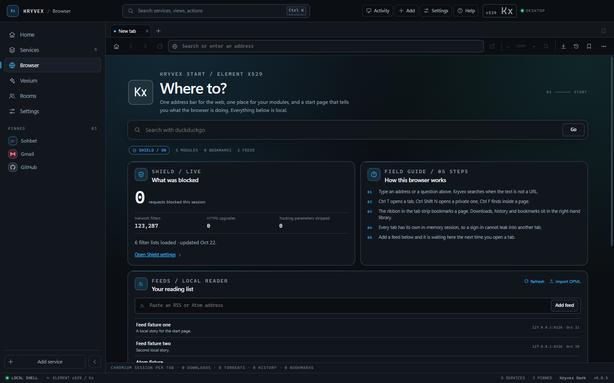

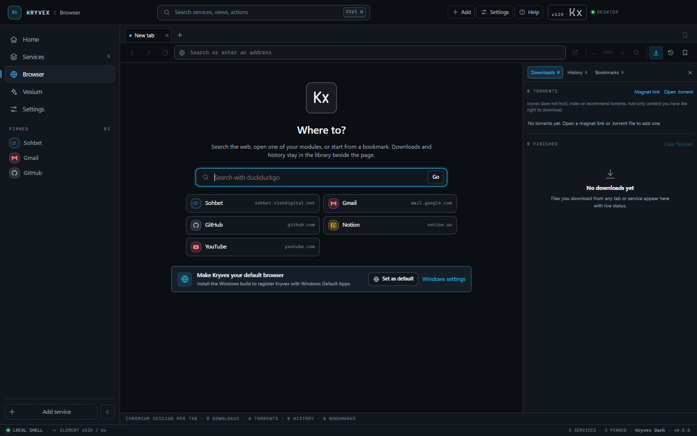

**Rooms** — presence, chat and one-click sharing of a screen, a window or a
single app.

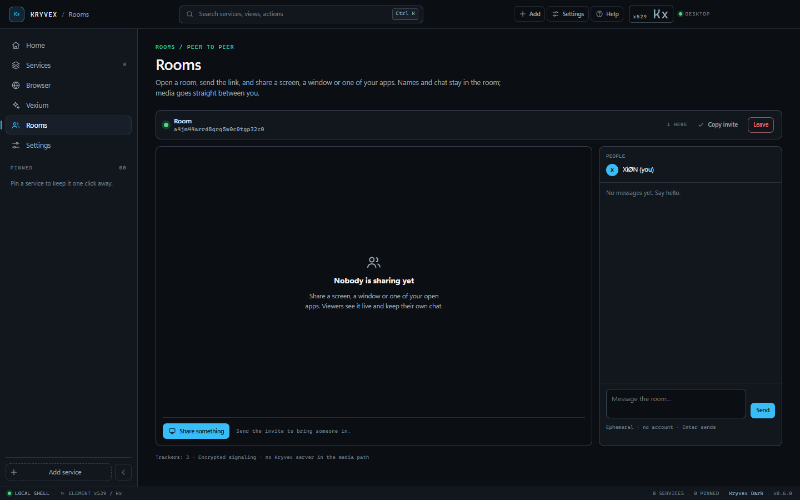

**Vexium** — a first-party chat surface for a model that runs on your machine.

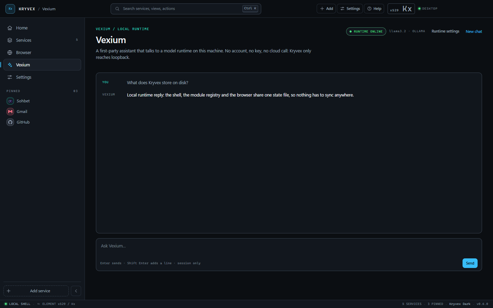

**Lexium** — dictation, translation and OCR in one panel.

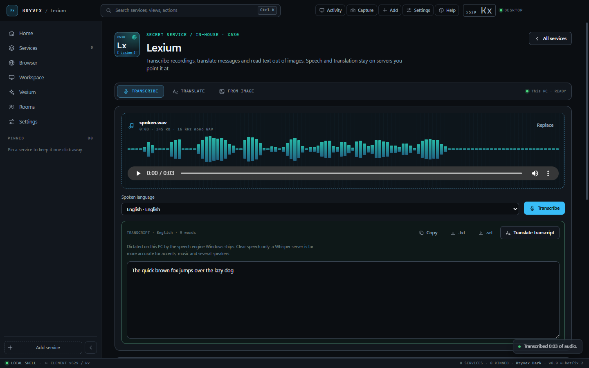

**The emulator** — your own ROMs, save states, optional netplay.

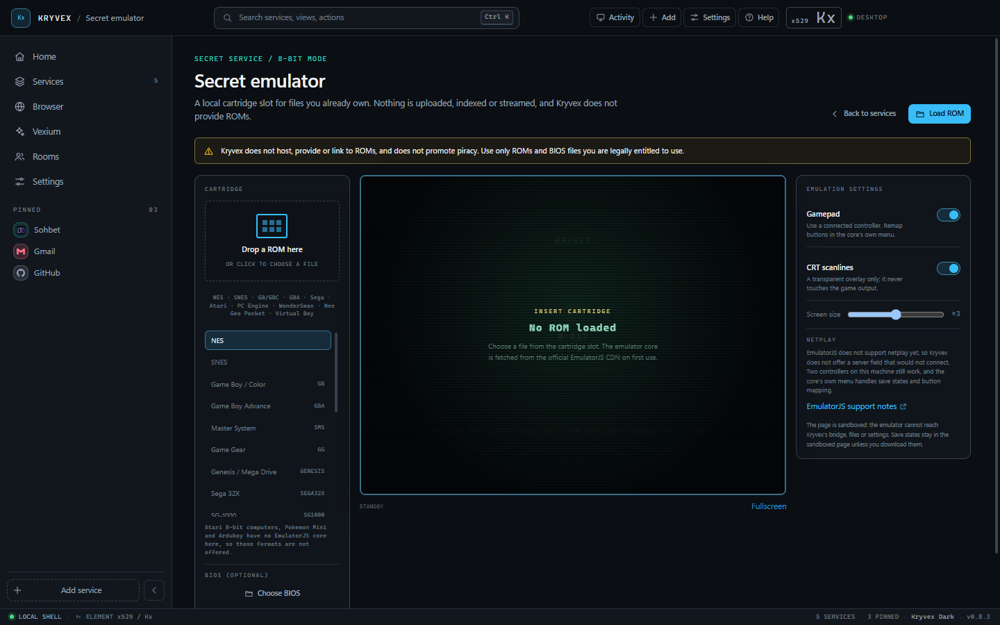

**Settings** — the periodic table, the gallery beneath it, and a colour studio
for the theme you build yourself.

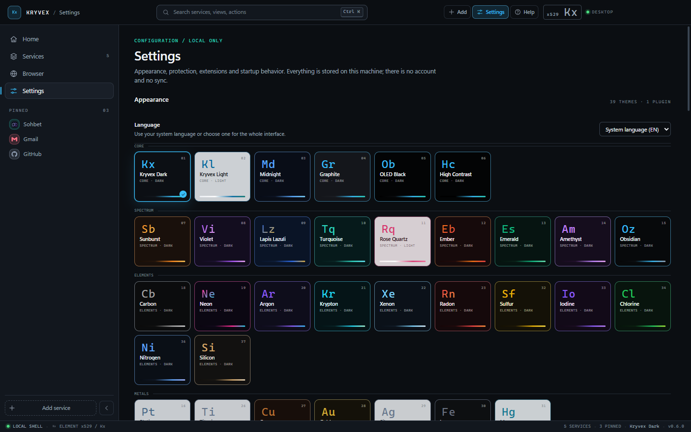

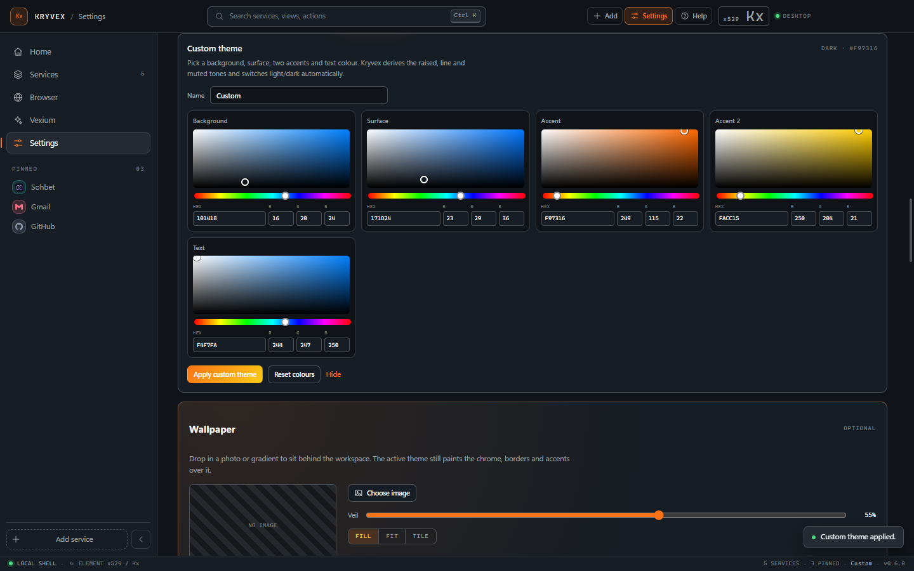

**First run** — compare families before committing to a look.

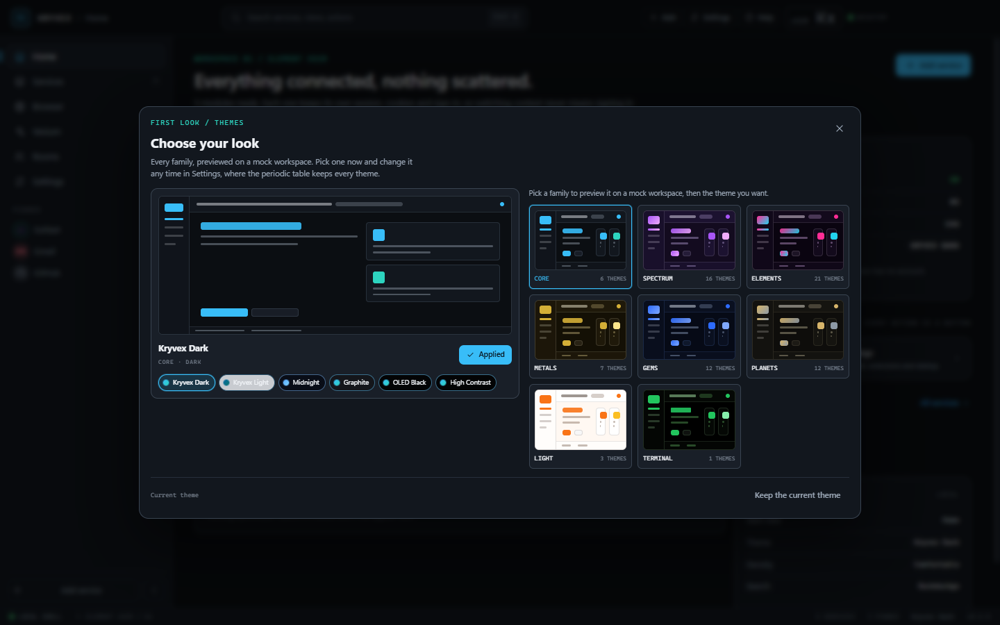

**Kryvex Shield** — real filter lists, a live blocked counter, and the credit
where it belongs.

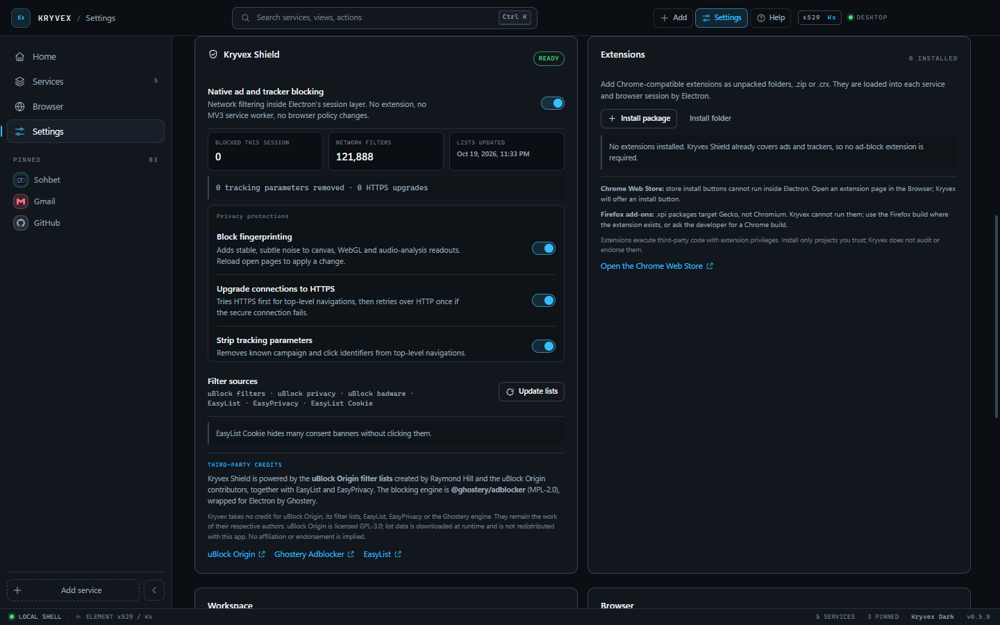

**The command palette** — optional, for when the keyboard is faster.

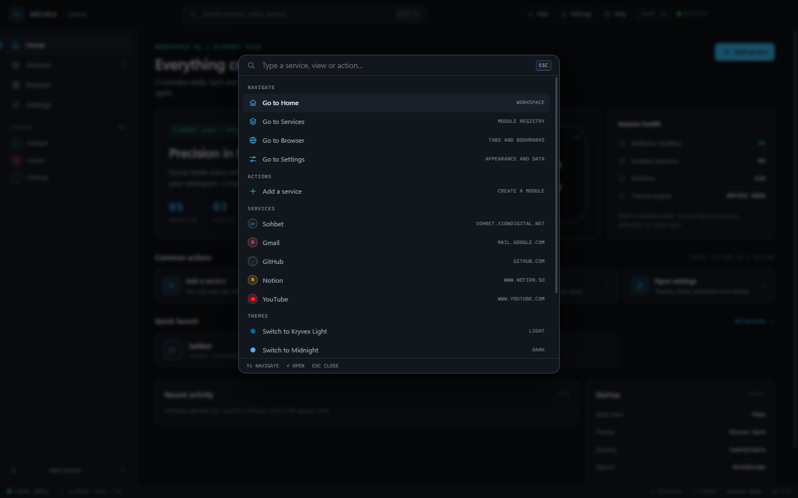

## Install on Windows

Kryvex targets Windows 10/11 x64. Download the current release from the
**[releases page](https://github.com/XiONDiGiTaL/Kryvex/releases/latest)**:

| Artifact | Use |
| --- | --- |
| `Kryvex-Setup-0.9.5-hotfix.9-x64.exe` | Standard per-user installer. Choose the folder, get Desktop and Start Menu shortcuts, uninstall from Windows Settings. No admin rights for the default location. |
| `Kryvex-Portable-0.9.5-hotfix.9-x64.exe` | Run without installing. State still lives in `%APPDATA%\Kryvex`. |

About 138 MB each. `SHA256SUMS.txt` travels with the pair and the in-app updater
verifies against it.

**Updates are built in.** **Settings → Updates** checks the public releases on
demand, and by default shortly after launch and every six hours. An installed
build downloads the Setup EXE, verifies its SHA-256, and installs on restart; a
portable build reveals the verified file for a manual swap; a git checkout links
to the release and never touches your tree. When there is nothing newer, the
panel says so in green instead of sitting there looking untouched.

> **Unsigned builds.** Code signing is not configured, so Windows SmartScreen
> may show **Unknown publisher**. Continue only if you built the artifact
> yourself or trust the release you downloaded.

**Kryvex Web.** The same renderer also builds as a browser client and installable
PWA: open **[xiondigital.net/Kryvex](https://xiondigital.net/Kryvex/)** on a
phone or desktop, then **Install app** in Chrome. The workspace, service
registry, themes, Home board, wallpaper, palette, bookmarks and history UI,
Lexium's translation and OCR, Vexium's offline answers, the emulator and the
media player all work there. Features that need the desktop shell — embedded
persistent sessions, Shield, extensions, downloads, torrents, VPN, local models,
screen share — say so plainly instead of failing silently. State lives in
`localStorage`. See [docs/WEB.md](docs/WEB.md) for the parity table.

## Privacy by construction

- **One local state file.** `kryvex-state.json` in Electron's `userData`,
  written atomically, capped at 1 MB, sanitised on every load. Corrupt or
  hostile input is never trusted.
- **Nothing phones home.** No account system, no backend, no telemetry, no
  remote config. The only independent traffic is the shield's filter download
  (first run, then weekly) and whatever your own modules load.
- **Disposable browsing.** Browser tabs use in-memory partitions cleared on
  close; service sessions are the only ones persisted, and each can be wiped
  individually with the lock button after a confirmation.
- **Prompted devices only.** A site asking for microphone or camera gets a shell
  owned modal naming the origin and the exact devices. Grants are per origin, in
  memory, and forgotten when Kryvex exits.
- **Locked-down content.** Remote pages attach with no preload and no Node,
  navigation is http(s) only, pop-unders are denied, and service sign-in windows
  are sandboxed onto their own session.

The full control-by-control table is in
[docs/SECURITY_MODEL.md](docs/SECURITY_MODEL.md).

## Adding anything to the workspace

1. **Add service** in the header, the dashed tile in the sidebar, or `Ctrl K`.
2. Pick a preset or type a name, URL, category and colour.
3. Save. Kryvex normalises the URL, assigns the partition, validates the module
   and pins it where you asked.

Modules are data, not code: they cannot execute in the shell, register hooks or
reach another module's session. Duplicate IDs, unsafe IDs, non-http(s) URLs,
unknown categories and off-palette colours are rejected before anything is
written. Presets are public web endpoints, not integrations — every service runs
its own code and login flow, and **Open externally** is there for the ones that
refuse to run embedded. There is no scraper and no credential collection in this
project.

## Honest limits

Stated here rather than discovered later:

- **Windows-first.** Kryvex runs on Electron and should work on macOS and Linux,
  but only Windows has been exercised, and packaging is Windows-only.
- **Unsigned.** Updates verify SHA-256 against the release's own checksum list,
  which proves the download matches the release, not who published it.
- **Shield is list-based.** Real filters, real blocking, but not the full uBlock
  Origin extension: no element picker, no per-site dynamic rules, and only
  uBO's `set`/`set-constant` scriptlet is implemented.
- **Fingerprint farbling is JavaScript-level.** It raises the cost of naive
  fingerprinting and is stable per site; a determined page can still detect the
  wrapper.
- **HTTPS upgrades cover top-level navigations**, with one silent HTTP fallback
  for legacy hosts. Subresource upgrades and interstitial warnings are not
  implemented.
- **Extensions are Chrome-shaped.** Firefox `.xpi` files cannot run, and
  extension code is third-party code Kryvex does not audit.
- **Sign-in is still the provider's call.** Google is handled specially so its
  full flow is served rather than the reduced embedded one, but a captcha, a
  device check or a tightened gate is outside Kryvex's control. **Reset session
  & retry** and **Open in my browser** exist for exactly that.
- **Torrents restore paused.** Nothing transfers after a restart until you press
  Resume; there is no bandwidth scheduler or ratio limit, and UPnP/PMP stay off.
- **Rooms are mesh.** Each viewer costs the sharer one upload, and peers behind
  strict NATs need a TURN relay you supply. File drop, voice and co-watch are
  planned, not shipped.
- **No sync, no Theme Studio, no delta updates.** State is local, themes are
  built-in or plugin-based, and every update downloads the full installer.

## Documentation

| Doc | What is in it |
| --- | --- |
| [SERVICES.md](docs/SERVICES.md) | How the module engine, sessions and presets work |
| [SECURITY_MODEL.md](docs/SECURITY_MODEL.md) | Every control, and what it does not cover |
| [THEMING.md](docs/THEMING.md) | Tokens, families, plugin themes, the Custom studio |
| [ASSISTANT.md](docs/ASSISTANT.md) | Vexium, runtimes, GGUF files, loopback rules |
| [LEXIUM.md](docs/LEXIUM.md) | Transcription, translation, OCR and their limits |
| [PLAYER.md](docs/PLAYER.md) | Queue, sources, the docked transport |
| [EMULATOR_ENGINES.md](docs/EMULATOR_ENGINES.md) · [NETPLAY.md](docs/NETPLAY.md) | Cores, save states, netplay |
| [DISK_PULSE.md](docs/DISK_PULSE.md) | The analyzer, the cleaner, its guard rails |
| [LINK.md](docs/LINK.md) | The phone companion and its security model |
| [PARTY.md](docs/PARTY.md) | Rooms: signaling, mesh cost, limits |
| [UPDATES.md](docs/UPDATES.md) | The release and checksum chain |
| [USERSCRIPTS.md](docs/USERSCRIPTS.md) | What a `.user.js` needs and where it runs |
| [I18N.md](docs/I18N.md) | Translation rules and the coverage ratchet |
| [WEB.md](docs/WEB.md) | The PWA build and its feature parity |
| [TESTING.md](docs/TESTING.md) | The suite and the scripted runs |
| [LEGAL.md](docs/LEGAL.md) | Privacy, terms, cookies, accessibility |

## Third-party work

Kryvex is designed and built by
[XiONDiGiTaL](https://github.com/XiONDiGiTaL) and
[player529](https://github.com/player529). It stands on work by others:

- **uBlock Origin** — filter lists (GPL-3.0), downloaded at runtime.
- **Ghostery Adblocker** — the filtering engine (MPL-2.0).
- **EasyList / EasyPrivacy / EasyList Cookie** — list maintainers (GPL-3.0).
- **WebTorrent** — the embedded BitTorrent client (MIT).
- **Simple Icons** — CC0 brand glyph paths; trademarks belong to their owners
  and identify the linked services only.
- **Qwen2.5-1.5B-Instruct** — the reviewed local model, Apache-2.0, with its
  upstream name kept visible.

Full notices: [docs/ATTRIBUTION.md](docs/ATTRIBUTION.md).

## Release history

Every release has its own verification record, artifact checksums and known
issues:

| Release | Record |
| --- | --- |
| 0.9.5-hotfix.9 | [RELEASE_0.9.5-hotfix.9.md](docs/RELEASE_0.9.5-hotfix.9.md) |
| 0.9.5-hotfix.8 | [RELEASE_0.9.5-hotfix.8.md](docs/RELEASE_0.9.5-hotfix.8.md) |
| 0.9.5-hotfix.7 | [RELEASE_0.9.5-hotfix.7.md](docs/RELEASE_0.9.5-hotfix.7.md) |
| 0.9.5 | [RELEASE_0.9.5.md](docs/RELEASE_0.9.5.md) |
| 0.9.4 | [RELEASE_0.9.4.md](docs/RELEASE_0.9.4.md) |
| 0.9.0 | [RELEASE_0.9.0.md](docs/RELEASE_0.9.0.md) |
| 0.8.8 | [RELEASE_0.8.8.md](docs/RELEASE_0.8.8.md) |
| 0.8.0 | [RELEASE_0.8.0.md](docs/RELEASE_0.8.0.md) |
| 0.7.0 | [RELEASE_0.7.0.md](docs/RELEASE_0.7.0.md) |

Earlier records (0.3.0 through 0.9.4-hotfix.3) sit in the same folder, and the
running scoreboard is [PROJECT_STATUS.md](PROJECT_STATUS.md).

## Build from source

Kryvex is open source, so the tree builds. This is not the intended way to use
it — the installer is.

```bash
pnpm install
pnpm dev:electron   # Vite + Electron with hot reload
pnpm typecheck      # renderer and main, strict
pnpm test           # unit suite
pnpm build          # dist/ + dist-electron/
pnpm package:win    # Setup and Portable EXEs into release/
```

Node 24+, pnpm 12+. The renderer alone can be previewed with `pnpm dev`, and the
PWA with `pnpm build:web`. `pnpm run fetch:runtime` pulls the pinned llama.cpp
runtime for local packaging; `runtime/` is never committed.

## License

Code and brand assets are released under the [MIT License](LICENSE). "Element
x529 / Kx" is a fictional brand device, not a claim about a chemical element.
Third-party data and libraries keep their own licenses: see
[docs/ATTRIBUTION.md](docs/ATTRIBUTION.md).

<div align="center"><sub>KRYVEX · ELEMENT x529 · PRECISION IN EVERY CONNECTION</sub></div>
