<div align="center">

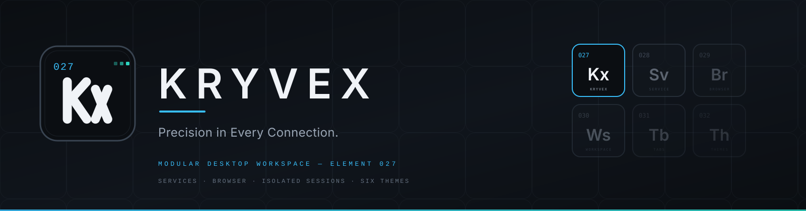

### A modular desktop workspace for the web apps you actually live in.

Kryvex turns independent services into first-class modules — each with its own
persistent session, a place in your sidebar, and one composed surface. It also
ships a native ad blocker, Brave-style URL privacy and fingerprint farbling, a
Chrome-extension loader and a browser with microphone/camera access for real
calls, without asking you to trust a browser policy.

[](LICENSE)
[](https://www.electronjs.org/)
[](https://react.dev/)
[](#known-limitations)
[](#kryvex-shield)

**[Demo reel](#demo-reel) · [Install on Windows](#install-on-windows) · [Pointer first](#pointer-first) · [Features](#features) · [Screenshots](#screenshots) · [Adding services](#adding-services) · [Shield](#kryvex-shield) · [Extensions](#extensions) · [Themes](#themes) · [Credits](#credits) · [Limitations](#known-limitations)**

</div>

---

## Demo reel

[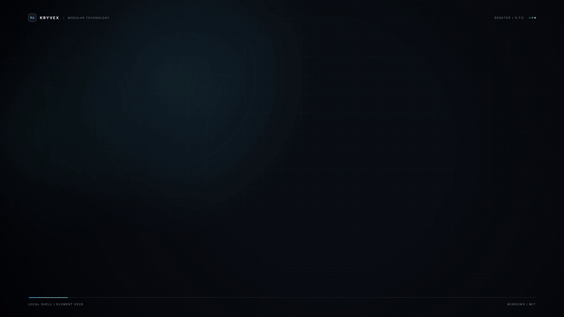](docs/media/kryvex-demo.mp4)

Twenty seconds, cut from the real app: modules instead of tabs, a persistent
session behind every service, 78 themes, and no account in sight.

**[Open the full reel](docs/media/kryvex-demo.mp4)** — 1920×1080, 30 fps, with
sound, 6.2 MB. The preview above is the same cut at 800×450 and 10 fps so it can
play inline like any image; the poster frame is
[here](docs/media/kryvex-demo-poster.jpg).

---

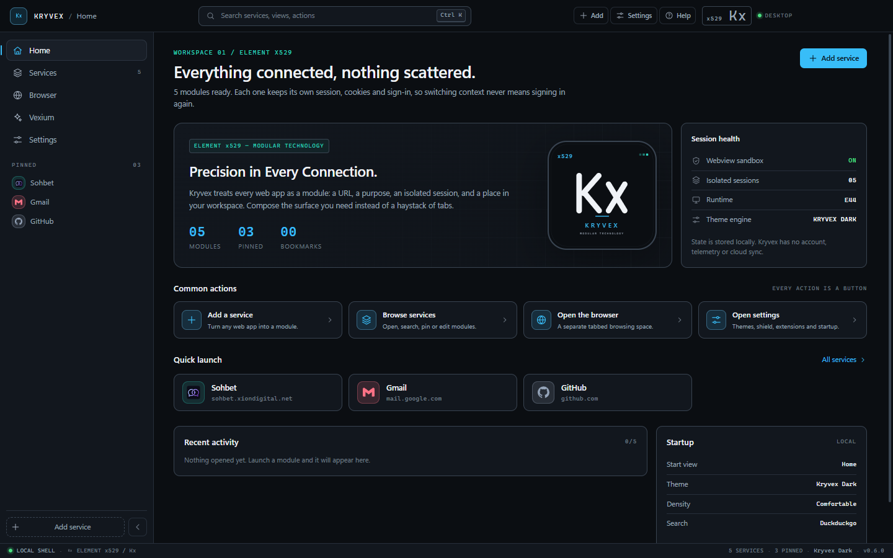

Home keeps the everyday actions in view: Add, browse services, open the
browser, or jump into settings — all ordinary buttons.

## Why Kryvex

Every team has the same stack of tabs: chat, mail, issues, notes, docs, a
dashboard, three internal tools. Browsers treat them as pages. Kryvex treats
them as **modules** — named, categorised, pinned, isolated, and one keystroke
away.

- **Modules, not tabs.** Add any web app by URL or pick a preset. Give it a
  name, category and colour. It gets a permanent tile, an isolated persistent
  session, and a place in your workspace.
- **No sign-in roulette.** Each service keeps its own persistent Chromium
  partition (`persist:svc-*`). Browser tabs use disposable in-memory partitions
  (`browser-*`) that are cleared when the tab closes, so casual browsing leaves
  no session behind.
- **Speaks your language.** The whole interface — navigation, settings,
  themes, help, browser library, extension results and errors — follows the
  system language or an explicit choice of English, Spanish, German or French.
- **Ads filtered natively.** Kryvex Shield runs uBlock Origin and EasyList
  filter data through Electron's own session layer. No MV3 service worker, no
  extension page, no browser-store dependency.
- **Your extensions, if you want them.** Drop in a Chrome-compatible `.zip`,
  `.crx` or unpacked folder. It is copied into Kryvex's user-data folder and
  loaded into each session.
- **A browser with a memory.** Tabs, searchable history, a full bookmark list,
  live download progress and a one-click Windows default-browser setup live in
  the same workspace. A page's pop-up opens as a tab, so a sign-in that needs a
  new window finishes inside Kryvex instead of leaving for the system browser.
- **Controls where you expect them.** Add, Settings and Help stay visible in the
  header, and Home puts the four most common actions in one strip. Keyboard
  shortcuts exist for speed, but they are not the only route through the app.
- **Keyboard when you want it.** `Ctrl K` opens the command palette for every
  view, service, action and theme. `Ctrl 1–6` jumps between Home, Services,
  Browser, Vexium, Rooms and Settings.
- **Local by design.** One JSON state file on your machine. No account, no
  telemetry, no cloud sync, no analytics SDK.
- **Vexium, a local assistant.** A first-party chat surface that talks to a
  model runtime on your machine — Ollama or LM Studio — over loopback only. No
  account, no key, no cloud call, no transcript on disk.
- **A real design system.** 78 catalogue themes in eight families — including
  reds, pinks, birthstones and the solar system — plus two creator plugins and a
  **Custom** slot,
  organised as a periodic table with two-letter symbols and full HSV/RGB colour
  pickers. Density modes, brand tokens, visible focus rings and reduced-motion
  support ride on the same tokens.

> Status: **working desktop prototype (0.8.4, packaged and published)**. The app boots, modules load, service apps stay running with their
> sessions, native notifications and unread badges work, auth popups complete
> inside the module, themes switch, the shield blocks tracker requests and
> consent banners, top-level navigations are upgraded to HTTPS with a one-time
> fallback, tracking parameters are stripped, canvas/WebGL/audio readbacks are
> farbled per site, the browser keeps downloads/history/bookmarks, calls can
> request the microphone and camera, rooms carry presence, chat and screen
> share, Vexium answers from a local model or a GGUF file you point it at,
> torrents live in the downloads hub,
> downloads and new torrents can use any writable folder you choose, and the
> Windows installer and portable build run. Builds are unsigned. The app
> checks GitHub Releases for updates, verifies the installer checksum and
> can install it on restart, says **UP TO DATE** in green when nothing newer
> exists; portable and git builds download or point at the release instead.

## Install on Windows

Kryvex targets Windows 10/11 x64. `pnpm run package:win` writes two artifacts
to `release/`:

| Artifact | Use |
| --- | --- |
| `Kryvex-Setup-0.8.4-x64.exe` | Standard per-user installer. Choose the destination folder, get Desktop and Start Menu shortcuts, and uninstall from Windows Settings. |
| `Kryvex-Portable-0.8.4-x64.exe` | Run directly without installing. State still lives in `%APPDATA%\Kryvex`. |

The **0.8.4** artifacts are built from the complete source tree by the
tag-triggered workflow and published on the
[GitHub releases page](https://github.com/XiONDiGiTaL/Kryvex/releases/latest).
`SHA256SUMS.txt` covers the two 0.8.4 artifacts, and the in-app updater relies
on it.
### Updates

Kryvex can update itself from this repository's public releases. **Settings →
Updates** checks on demand, and by default once shortly after launch and every
six hours. Nothing downloads until you choose **Download update**.

| Build | What an available update does |
| --- | --- |
| Installed (NSIS) | Downloads the Setup EXE, verifies its SHA-256 checksum, then **Install and restart** closes Kryvex and launches the verified installer. |
| Portable | Downloads and verifies the Portable EXE, then shows it in Explorer so you can run it after closing Kryvex. A running EXE cannot replace itself. |
| Git checkout | Reports the newer release and opens its page. The working tree is never modified; use `git pull`. |

The update check contacts only `api.github.com` for `XiONDiGiTaL/Kryvex`, uses
stable releases only, and rejects assets that are not GitHub-hosted or do not
match the release version. A release is ignored unless it publishes
`SHA256SUMS.txt` with a matching entry. See [docs/UPDATES.md](docs/UPDATES.md)
for the full trust chain and release steps.

Installed builds from 0.6.0 onward can update themselves from later releases.
Older installs predate the updater, so update those once by running the 0.6.0
installer.

The setup is not click-through: it opens a normal Windows wizard, lets you
pick the install location, and can launch Kryvex when it finishes. The default
per-user install needs no administrator rights; choosing a protected folder
will ask for elevation. It creates Desktop and Start Menu shortcuts and an
uninstall entry in Windows Settings.

The **0.8.4** Setup and Portable EXEs are built from this tree by the release
workflow. Artifact checksums, verification steps and limitations are recorded
in [docs/RELEASE_0.8.4.md](docs/RELEASE_0.8.4.md); earlier releases are in
[docs/RELEASE_0.8.3.md](docs/RELEASE_0.8.3.md),
[docs/RELEASE_0.8.2.md](docs/RELEASE_0.8.2.md),
[docs/RELEASE_0.8.1.md](docs/RELEASE_0.8.1.md),
[docs/RELEASE_0.8.0.md](docs/RELEASE_0.8.0.md),
[docs/RELEASE_0.7.0.md](docs/RELEASE_0.7.0.md),
[docs/RELEASE_0.6.0.md](docs/RELEASE_0.6.0.md) and
[docs/RELEASE_0.5.0.md](docs/RELEASE_0.5.0.md).

**Unsigned build notice.** Code signing is not configured yet, so Windows
SmartScreen may show **Unknown publisher**. Only continue if you built the
artifact yourself or downloaded it from a release you trust.

## Kryvex Web (non-Electron)

The same renderer also builds as a browser client and an installable PWA:

```bash
pnpm build:web
python -m http.server 4173 -d dist-web
```

The web client keeps the workspace, service registry, themes, Home board and
weather, tasks, wallpaper, command palette, bookmarks/history UI, Vexium's
offline answers and search fallback, and the 8-bit emulator (when the EmulatorJS
CDN is reachable). State lives in `localStorage`; the shell caches itself for
offline use after the first visit. Services open in their own browser tabs, and
the panels that need Electron — embedded persistent sessions, Shield,
extensions, downloads/torrents, VPN, local models, screen share — say so
instead of failing silently.

On an Android phone, open the HTTPS (or `localhost`) build in Chrome and use
**Install app**. See [docs/WEB.md](docs/WEB.md) for the build, hosting, USB
fallback and the full feature-parity table.

## What's new in 0.8.4

Services became a working platform. Steam's session cookies are promoted so a
Steam module stays signed in across restarts, and a one-time-code strip can
relay Steam Guard and other sign-in codes into a single field or a row of
one-character boxes. Home gained a clock, weather, sticky tasks, a guide and a
live resource monitor; Settings gained an OpenVPN control panel and a search
engine catalogue grouped by region. Vexium answers app questions offline and
falls back to search when no local model is loaded, and Services → Secret
emulator runs 8-bit ROMs you already own through EmulatorJS. Settings were
reorganized into collapsible blocks, and every new panel is translated into
English, Spanish, German and French. CI and the release workflow now run the
one-time-code relay harness. Everything in 0.8.3 is included.

## What was new in 0.8.3

A page's `window.open` used to leave Kryvex for the system browser, so a Google
or Microsoft sign-in finished in another application and the page that started
it waited forever for the message that ends the flow. The popup now stays in
Kryvex: it keeps its own window — and with it `window.opener` and the session
the provider needs — while the tab strip shows it as a tab with the page's
title, a close button and back/forward/reload, and the window is placed exactly
over the browser canvas so the toolbar and tabs stay yours. Another tab hides
it, the tab shows it again, and `window.close()` returns you to the page that
opened it. Service modules keep the sign-in window beside their stage. Electron
cannot move that page into a tab view ("already attached to a window"), and
moving it is what would break the sign-in, which is why the window is real and
the tab is the shell's view of it. Everything in 0.8.2 is included.

## What was new in 0.8.2

Closing the app was only the most visible read of a window that no longer
existed. This release guards the rest of the class. Choosing a download folder,
installing an extension, or opening a `.torrent` used to hand the dialog a
window that could already be destroyed, which threw inside the picker and became
the blocking **“A JavaScript error occurred in the main process”** dialog; each
now answers **“The main window is not ready.”** The IPC sender check and the
permission broker compare a web contents reference captured while the window was
alive, and Rooms checks that its shell is alive before touching `mainFrame`.
`pnpm audit:lifecycle` walks every `closed`/`destroyed` handler and fails if one
reads a window again — the test suite runs it, and runs it against the old
crashing line to prove it still catches it. `pnpm verify:guards` drives the
three compiled pickers with a destroyed window and an Electron stub that counts
dialog requests. Everything in 0.8.1 is included.

## What was new in 0.8.1

One fix: closing the app no longer raises **“A JavaScript error occurred in the
main process — TypeError: Object has been destroyed”**. The Rooms broker read
`win.webContents` inside the window's `closed` handler, where the window is
already gone; it now compares against a reference captured when the window was
attached. `pnpm verify:party-close` fails with `Object has been destroyed` if the
old read comes back. Everything in 0.8.0 is included.

## What was new in 0.8.0

Run the model you already have, sign in where Electron was refused, and filter
with lists you chose. Kryvex still hosts nothing and uploads nothing.

- **Run a model file:** **Settings → Vexium → Run a model file** takes a `.gguf`
  you already downloaded and starts llama.cpp's `llama-server` against it on a
  free loopback port, bound to `127.0.0.1` so nothing reaches the LAN. A large
  file shows `starting → running` while it loads, context size and GPU layers
  are adjustable, and **Stop server** or quitting ends the process. Kryvex ships
  no weights and checks no remote catalogue.
- **A Chrome identity for embedded pages:** guests report
  `Google Chrome / Chromium / Not(A:Brand` with full client hints through
  `getHighEntropyValues` and `Sec-CH-UA` on the wire, so Google stops treating a
  module as an anonymous Electron window. Fingerprint farbling still hides its
  JavaScript wrappers from `Function.prototype.toString`.
- **My filters:** the shield accepts the uBlock Origin syntax people already
  paste — `||ads.example.com^`, `example.com##.ad`, `example.com##+js(…)` — and
  compiles it from the cached lists, so applying needs no download. Scriptlets
  sit behind their own switch, the editor imports and exports plain text, and a
  YouTube preset bundles ad and feed blocking for one site.
- **Sign-ins survive a restart:** every service partition's cookie store is
  flushed before the window closes, capped at 1.5 s, so a module signed into
  minutes before quit reopens signed in.
- **Up to date, visibly:** a check that finds nothing newer shows a green
  **UP TO DATE** verdict beside the running version, and a manual check confirms
  with a toast naming that version instead of looking like nothing happened.
- **Translation coverage is enforced:** `npm run audit:i18n` scans JSX text and
  human-facing attributes for strings that bypass `t()`, and the test suite runs
  that audit, so a hardcoded sentence fails CI.

## What was new in 0.7.0

Rooms, a local assistant, a real engine panel, and a first run that starts with
a look instead of a list.

- **Rooms:** create a room, copy one invite, and everyone who opens it lands in
  the same place. Presence with names and colours, ephemeral text chat, and
  screen share of a whole screen, a window or a single Kryvex app. No account
  and no Kryvex server in the media path — the invite link is the access model,
  and recent rooms bring a group back. File drop, voice and co-watch are not
  built yet.
- **Vexium, a local assistant:** a first-party chat surface that talks to
  Ollama or LM Studio over loopback. The renderer never reaches the model
  server; the main process enforces a loopback-only address on every request,
  streams the deltas and keeps no transcript on disk.
- **Chromium engine panel:** Settings exposes the switches Chromium actually
  boots with (hardware acceleration, smooth scrolling) and per-page
  preferences (JavaScript, images, WebGL, PDF viewer, autoplay, background
  throttling, spellcheck, colour scheme, default zoom). A live report shows the
  engine version, GPU state and what each open guest attached.
- **First look:** a fresh install opens a family gallery — eight bands, nine
  mock workspaces — so you compare looks before committing. Previews never
  apply; clicking a theme does. Existing profiles are marked as seen, so an
  upgrade never interrupts.
- **Wallpaper on your terms:** off by default, so the active theme paints the
  window. Turn it on for a **theme wash** built only from that theme's accent
  tokens, or your own photo with a veil and fill/fit/tile. Images never leave
  the machine.
- **Fits your screen:** the window opens at the display's work area instead of a
  fixed 1440×900, keeps a real 900×520 floor, and a layout sweep at ten sizes
  proves no panel clips its own content.
- **Planets retuned:** Uranus is a pale, eerie ice teal, Turquoise a pale mint
  and Neptune a vivid navy — 78 catalogue themes in eight families plus two
  creator plugins and the Custom slot.

## What was new in 0.6.0

Kryvex now runs services like installed apps rather than browser pages.

- **Sessions that stay signed in:** a service is mounted once and kept alive
  while you work elsewhere, its partition is applied before the page loads, and
  the guest reports a Chrome user agent instead of Electron. Reloading a view is
  no longer enough to end a chat session.
- **Desktop notifications:** installed services can raise native notifications
  and taskbar alerts. Throwaway browser tabs stay blocked. Toggle in
  **Settings → Service apps**.
- **Unread badges:** `(3) Discord`-style page titles produce counts in the
  toolbar, on sidebar pins and in the window title, and flash the taskbar when a
  message arrives in the background.
- **Sign-in popups:** OAuth and passkey flows open a sandboxed child window on
  the same service session. Background pop-unders from ordinary browsing are
  denied.
- **Clear one session:** the lock button in a service toolbar deletes only that
  service's cookies, storage and cache, after confirmation.
- **A real catalogue:** 26 presets across communication, work, AI and resources
  — Discord, Steam, Messenger, WhatsApp, Telegram, Instagram, Gmail, ChatGPT, Claude,
  Gemini, Copilot, Perplexity, Hugging Face, Freebuff, Ollama, FMHY and more.
  Links read while building Kryvex are not shipped as presets.
- **A periodic theme table:** the picker is a periodic-table grid with
  two-letter symbols, family bands and palette strips — core, spectrum (with
  Crimson, Vermillion and a pink range), flame-test elements, metals
  (Quicksilver included), birthstone **gems**, **planets**, lights and a
  high-contrast **Terminal**. Platinum and Quicksilver add an aero-style glass
  sheen; gradient themes paint buttons and marks with an accent-to-accent
  gradient.
- **Custom colours:** the **Custom** tile opens a five-picker colour studio —
  hue/saturation field, rainbow slider, HEX and editable R/G/B — that derives
  the remaining tones and switches light/dark from the background luminance.
- **In-app updates:** **Settings → Updates** checks GitHub Releases, verifies
  the installer against a mandatory `SHA256SUMS.txt`, and can install and
  restart. Portable and git builds get the release page instead.
- **Docs that take a position:** [SERVICES.md](docs/SERVICES.md) explains the
  engine, [PLATFORM_PLAN.md](docs/PLATFORM_PLAN.md) triages client mods,
  compounds, local models and the emulator idea, [UPDATES.md](docs/UPDATES.md)
  covers the release/checksum chain, and [LEGAL.md](docs/LEGAL.md) holds the
  privacy/terms/cookies/accessibility pack.

## What was new in 0.5.0

- **Choose where files go:** **Settings → Data** now shows the active download
  folder and opens the native Windows folder picker. Regular downloads save
  directly into it; new torrents use its `Kryvex Torrents` subfolder.
- **One click back to normal:** **Use the Downloads folder** restores the
  system Downloads folder. The choice is stored in
  `userData/kryvex-storage.json` and survives restarts.
- **Validated, not guessed:** the location must be an absolute, writable
  directory. A damaged or hand-edited config falls back safely, and the app
  never writes outside a folder it has checked.
- **Old files stay yours:** previously used folders are retained, so existing
  downloads and torrent rows can still be opened, resumed or deleted after a
  change.
- **Localized:** the new controls and errors follow the system language or an
  explicit choice of English, Spanish, German or French.

The 0.4.0 features below — the browser library, session restore, find/zoom,
privacy protections, calls, torrents and extensions — are all included in
0.5.0.

## What was new in 0.4.0

- **Brave-style privacy protections:** top-level HTTP navigations try HTTPS
  first and retry once over HTTP when the secure connection is unavailable;
  known campaign and click identifiers are removed before the request; and
  canvas, WebGL and audio-analysis readbacks receive stable per-site noise.
- **Consent-banner filtering:** EasyList Cookie joins the native shield lists,
  so many cookie notices are hidden without an extension or a click.
- **Privacy controls:** fingerprinting, HTTPS upgrades and tracking-parameter
  stripping have independent switches and session counters in **Settings →
  Shield**.
- **Browser library:** a panel beside the page with **Downloads**, **History**
  and **Bookmarks** tabs. See live progress, pause/cancel, open a finished file
  or its folder, delete a saved file, search history, and reopen or remove
  bookmarks. Download history survives a restart; interrupted transfers are
  labelled rather than shown as running.
- **A browser that comes back:** open tabs and the active tab are restored after
  a restart, with `Ctrl F` find-in-page and `Ctrl +` / `Ctrl -` / `Ctrl 0` page
  zoom in the toolbar.
- **Calls that work:** sites can ask for the microphone and camera through a
  visible Kryvex prompt. Discord, WhatsApp, Messenger, Instagram and Telegram
  web calls can use the same input devices as any Chromium browser.
- **Torrents in Downloads:** open a magnet link or `.torrent` file and it lands
  in the downloads hub with live seeders/leechers, transfer speeds, ratio,
  protocols, trackers and file lists. Kryvex does not host, index or recommend
  torrents; it is a client for content you have the right to use.
- **A torrent queue that waits:** queue rows survive a restart and come back
  paused. No client, discovery or transfer starts until you press Resume; the
  saved `.torrent` or magnet is then rehydrated and the local pieces are
  checked again.
- **Default-browser setup:** an installed Windows build registers per-user
  Default Apps capabilities for `http` and `https`, hands the final choice to
  Windows Default Apps, and opens links passed by Windows in a Kryvex tab.
- **Deeper browser navigation:** deep links such as
  `#/browser?url=https%3A%2F%2Fexample.com` open a page directly in a tab.
- **Cleaner project:** obsolete reference-analysis documents were removed;
  Kryvex is documented as an independent, purpose-built application.

## What was new in 0.3.0

- **Visible controls:** Add, Settings and Help buttons in the header, plus a
  Common actions strip on Home — search, categories, browser and preferences
  are reachable without a single keyboard shortcut.
- **Quick help:** a clickable guide for adding a service, browsing modules,
  opening the browser, opening settings, and the optional key combinations.
- **About credits:** XiONDiGiTaL and player529 are linked under **DEVELOPERS**,
  and the element reads **x529** throughout the app and brand assets.
- **Windows release:** separate named Setup and Portable EXEs, a selectable
  install folder, Desktop/Start Menu shortcuts, and an uninstaller.

## Pointer first, keyboard when you want it

Kryvex is a browser at heart, so it behaves like one: tabs, the address bar,
back/forward, page content and context menus work the way you expect. Around
that browser, the workspace keeps its controls visible instead of hiding them
behind a shortcut sheet.

- **Header:** **Add**, **Settings** and **Help** are always visible.
- **Home:** four large **Common actions** cards cover add, browse, browser and
  settings.
- **Sidebar:** Home, Services, Browser and Settings are one click away at all
  times.
- **Help dialog:** four clickable actions plus a plain-language shortcut
  reference for anyone who wants it.
- **In context:** service cards open on click, settings use switches and
  dropdowns, and dialogs have visible Save/Cancel/Close buttons.

Keyboard shortcuts are accelerators, not a requirement. Use them when they are
faster; the same actions remain available on screen.

## Features

| Area | What works today |
| --- | --- |
| **Module registry** | Add, edit, remove and pin services. Name, URL, category, colour, glyph and brand-icon validation. Search, category filters, recents, starter catalogue, duplicate-safe IDs. |
| **Vexium** | Chat with a local Ollama or LM Studio runtime over its OpenAI-compatible API, or a GGUF file Kryvex starts locally. Offline app answers and a search fallback when no model is loaded, streamed replies, Stop, runtime/address/model settings. Loopback http only; prompts stay in the session and no key or weights are stored. |
| **Home board** | Greeting and clock, opt-in Open-Meteo weather with a ten-minute cache and °C/°F, sticky tasks and a guide. Widgets hide independently. |
| **Resource monitor** | CPU, system memory, the Chromium GPU process and per-service/per-process usage, in the sidebar or a full view. Samples only while visible. |
| **VPN** | Start and stop an OpenVPN tunnel from your own binary and profile, with DNS, proxy, extra flags and connect-on-launch. Dangerous helper flags are refused. |
| **Search engines** | Worldwide, Chinese, Korean, Czech, Vietnamese and international engines shared by the address bar, Settings and Vexium. |
| **8-bit emulator** | EmulatorJS cores for NES, SNES, Game Boy/Color, GBA, Master System, Game Gear, Genesis, 32X, SG-1000, WonderSwan, Atari 2600/7800/Lynx, PC Engine, Neo Geo Pocket and Virtual Boy. Local ROMs only. |
| **Service catalogue** | 26 presets across communication (Discord, Steam, Messenger, WhatsApp, Telegram, Instagram, Gmail, X), work (GitHub, Linear, Notion, Figma, Trello), AI (ChatGPT, Claude, Gemini, Copilot, Perplexity, Hugging Face, Freebuff), resources (FMHY, Ollama, Internet Archive) and media (Spotify, YouTube, Reddit), with brand marks and honest notes about embedding limits. Sources read while building the shell stay out of the catalogue. |
| **Brand icons** | Built-in CC0 Simple Icons paths for known services. Unknown services request their own `/favicon.ico` directly, then fall back to a letter tile. No third-party favicon service. |
| **Isolated sessions** | One persistent partition per service; disposable in-memory partitions per browser tab, cleared on close. Cookies and sign-in stay inside the module. Opened services stay mounted, so a view change never reloads them. |
| **Service apps** | Keep-alive webview, native notifications, unread badges, sandboxed OAuth popups on the same session, a persistent Steam session, an in-service one-time-code relay for Steam Guard, other sign-in codes and split one-character boxes, per-service session clearing, reload, open externally, edit, remove, loading bar and an error state with retry. A Chrome-shaped user agent replaces Electron's. |
| **Browser** | Tabs that reopen after a restart, back / forward / reload, address bar with host-or-search resolution, per-tab in-memory session, find-in-page (`Ctrl F`), page zoom (`Ctrl +` / `Ctrl -` / `Ctrl 0`), bookmarks bar, system-browser handoff, direct URL deep links. |
| **Browser library** | Downloads, history and bookmarks in a side panel. Live download progress, pause/resume, cancel, show in folder, remove and delete-file actions; searchable history with clear/remove; full bookmark list. |
| **Downloads** | Chromium downloads are observed in the main process across services and browser tabs, saved to the folder chosen in **Settings → Data** (Downloads by default) with collision-safe names, and exposed only as tracked display records. Finished history is written to `userData/kryvex-downloads.json`, so the library survives a restart; a download interrupted by quitting is shown as interrupted. |
| **Torrents** | Magnet links and `.torrent` files open into the Downloads hub. New torrents use a `Kryvex Torrents` subfolder inside the chosen download location. Live progress, seeders/leechers, download/upload speed, ratio, time remaining, protocols, trackers and file list; pause/resume, reveal folder, remove, and optional data deletion. The queue is written to `userData/kryvex-torrents.json` and restored paused after a restart; no transfer resumes until the user presses Resume. Kryvex does not host, index or recommend torrents. |
| **Rooms** | A link-only hangout view: create a room, copy the invite, and everyone who opens it shares presence, a name, a colour and ephemeral chat. Share a whole screen, a single window, or one Kryvex service app (Discord, a browser tab, Vexium) — optionally with system audio on Windows — with peers connecting directly over WebRTC. Signaling rides public WebTorrent trackers, media never touches a Kryvex server, and no account is involved. Capture is shell-only, one armed source at a time, and every viewer costs the sharer one upload (mesh). |
| **Calls** | A visible prompt grants microphone and camera access per site. Works in service modules and browser tabs, so Discord, WhatsApp, Messenger, Instagram and Telegram web calls can use the local devices. Other permissions remain denied. |
| **Default browser** | Opt-in per-user Default Apps capabilities for `http` and `https`, Windows handoff, status readout, and command-line link handling. |
| **Kryvex Shield** | Native network filtering from uBlock Origin filters, uBO Privacy/Badware, EasyList, EasyPrivacy and EasyList Cookie. Live blocked counter, filter count, update-now, cached engine, per-session attachment. No MV3. |
| **URL privacy** | Top-level HTTP navigations are upgraded to HTTPS and retried over HTTP once if HTTPS fails. Known `utm_*`, `fbclid`, `gclid`, `msclkid` and similar click/campaign identifiers are removed before the request. Loopback, `.local` and private-network hosts are exempt. |
| **Fingerprint farbling** | A sandboxed frame preload perturbs canvas `getImageData`/`toDataURL`/`toBlob`, WebGL `readPixels` and `AnalyserNode` frequency data with stable per-site, per-launch noise. The trusted shell is never patched. |
| **Extensions** | Install Chrome-compatible extensions from a Chrome Web Store detail page in one click, or from `.zip`, `.crx` or a folder; enable, disable, remove. Loaded into services and browser sessions. |
| **Languages** | System language or English, Spanish, German and French across the shell, browser library, dialogs, themes and extension messages. |
| **Themes** | 78 catalogue themes in eight periodic-table families — core, spectrum (reds and pinks included), elements, metals, **gems/birthstones**, **planets**, lights and terminal — plus the **Special Donkey Edition** and **Special XiØN Edition** plugins, and a **Custom** tile you build from five RGB/HSV colour pickers. XiØN is the creator skin: near-black glass, one electric blue, the blade mark and liquid progress fills. All token-driven from `brand/themes.json` and `src/plugins/`. |
| **Theme gallery** | A preview-first route to the same catalogue: every family rendered on a miniature Kryvex workspace, opened once on a fresh install and kept below the periodic table in Settings. Picking a family previews its hero, clicking a theme applies it, and the skip button keeps the current look. |
| **Layout** | Collapsible sidebar (rail ↔ expanded), comfortable/compact density, toggleable status bar, adjustable start view. |
| **Usability** | Header Add / Settings / Help buttons, Home common-action cards, a clickable quick-help dialog, visible dialog buttons, and optional keyboard shortcuts. |
| **Command palette** | Fuzzy-ish filter over navigation, actions, services and themes; arrow keys, `Enter`, `Esc`. Optional — every action also has a visible button. |
| **Persistence** | Debounced writes with an atomic temp-file rename, 1 MB cap, defensive sanitisation on every load. Reset restores starters. |
| **Security** | Sandboxed renderer, context isolation, fixed IPC bridge, sender checks on every IPC call, hardened webviews, partition allowlist, http(s)-only navigation, prompt-only microphone/camera access, denied device permissions, display capture granted to the shell only while a Rooms source pick is armed, externalised popups, GPC, referrer trimming, no-pings, no DNS prefetch, WebRTC public-interface policy, HTTPS upgrades with a one-time fallback, tracking-parameter stripping and per-site fingerprint farbling. |
| **Quality** | 354 unit tests, strict TypeScript across renderer and main, production build, packaged-app run, real screenshots from the running window, and harnesses for restart persistence, download history and location, torrent restore, find-in-page, zoom, the updater, the theme gallery (first-run flow, family previews, persistence), a layout sweep that fails on clipped content across ten window sizes, and two-instance Rooms (presence, chat, screen share). |

## Screenshots

All captures below come from the running Electron window at 1440×900, produced
by the app's own capture routine or a live DevTools run against the same window
— no mockups.

### Help — a clickable guide

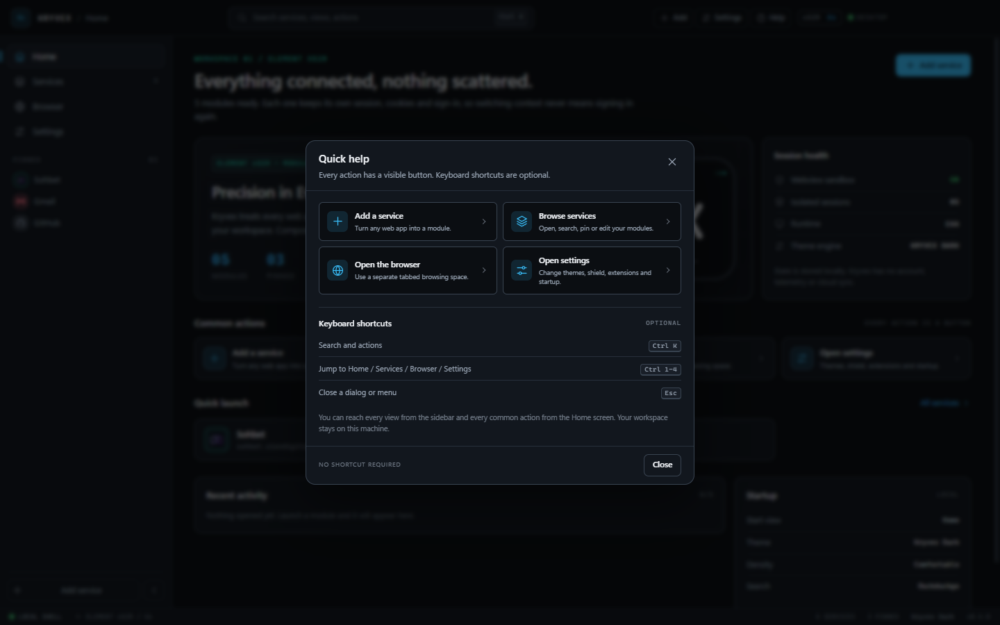

The Help button opens a clickable guide, not a keyboard cheat sheet. Shortcut
commands are listed separately as optional accelerators.

### Services — the module registry

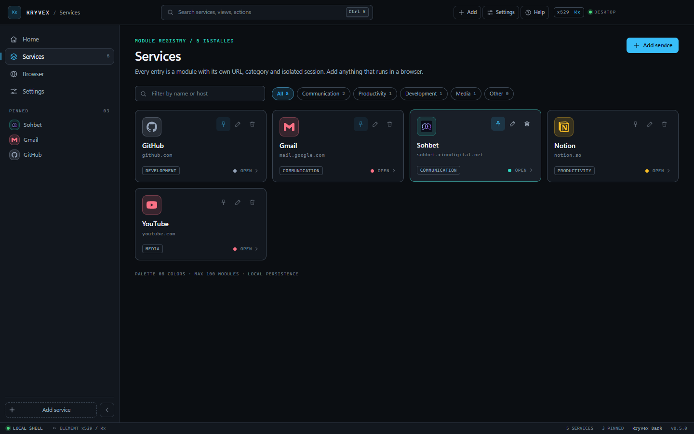

Cards carry the module colour, category, host, pin state and inline actions.
Filter chips double as a quick inventory of how your workspace is composed.

### Adding a service from the catalogue

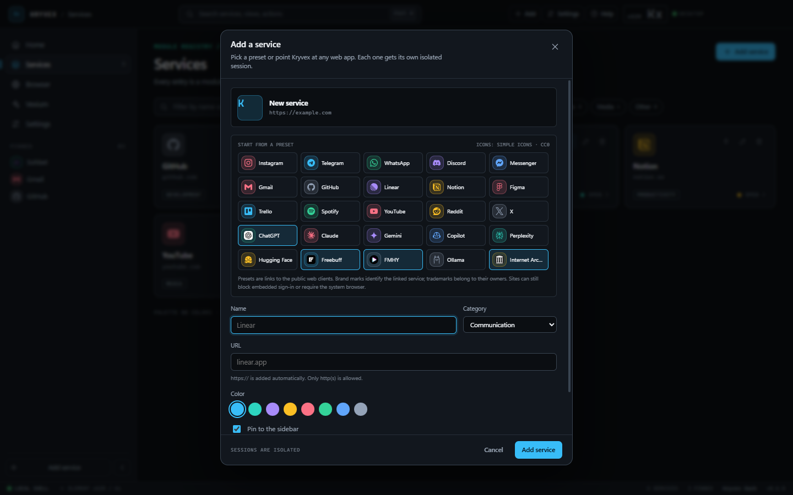

Pick Instagram, Telegram, WhatsApp or another preset, or enter any URL. URLs
are normalised (`linear.app` → `https://linear.app`), restricted to http(s),
and validated before a module is created.

### A service running in its own session

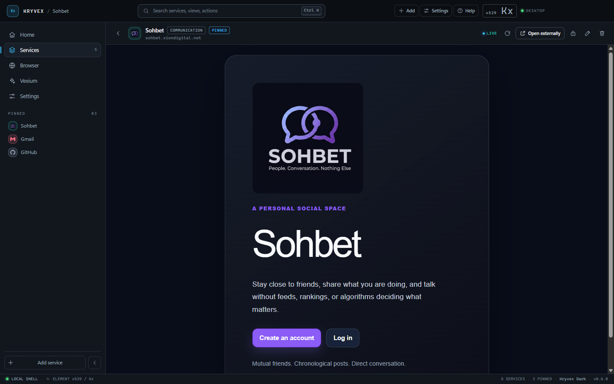

The module fills the workspace while the shell keeps identity, session state
and controls. Closing Kryvex and reopening it later keeps the session alive.

### Browser

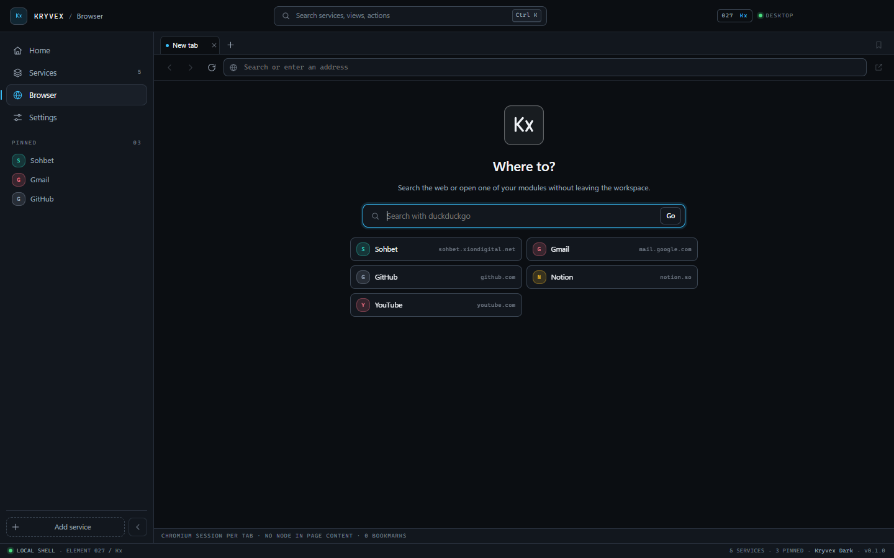

A real Chromium workspace: tabs, history navigation, address bar, bookmarks,
and a start page that surfaces your modules. Each tab has its own in-memory
Chromium session, cleared when the tab closes.

### Browser library — downloads and history

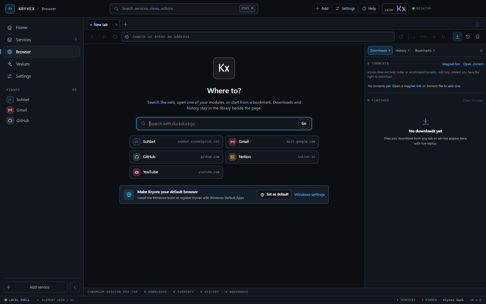

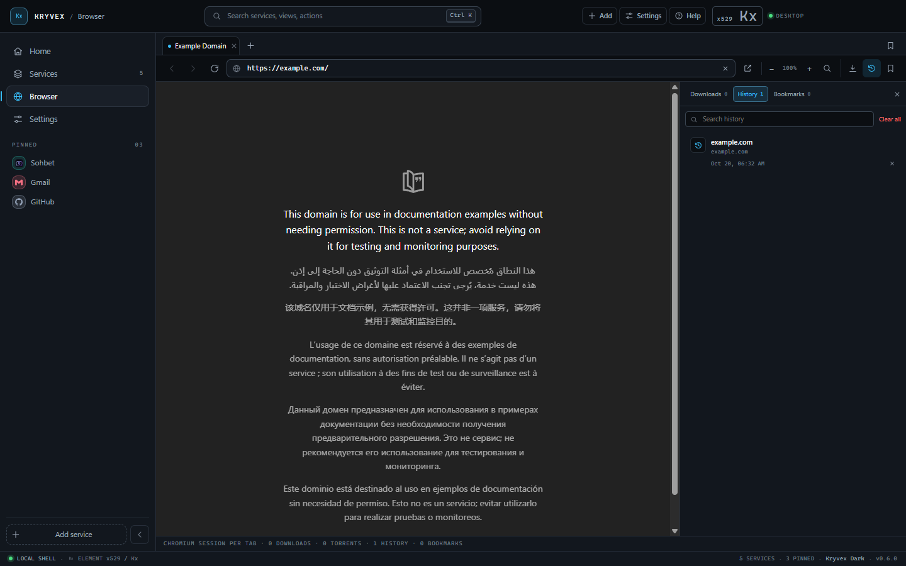

The library stays beside the page. Downloads show their live state and size;
history records visits with time and host; bookmarks use the same panel. Every
row has a visible action, and the keyboard shortcuts remain optional.

### Torrents inside the Downloads hub

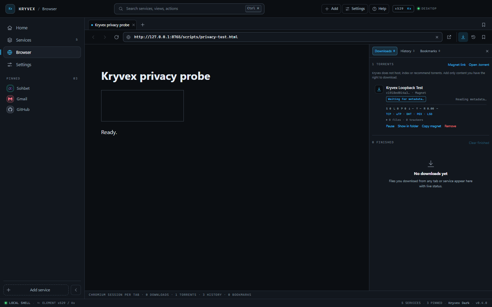

Magnet links and `.torrent` files open here, never in a standalone page. The
row carries live seeders, leechers, peers, down/up speed, ratio, remaining
time, active protocols, trackers and the file list. Kryvex is a client, not a
directory: it does not host, index or recommend torrents.

### Rooms — share a screen, a window or an app

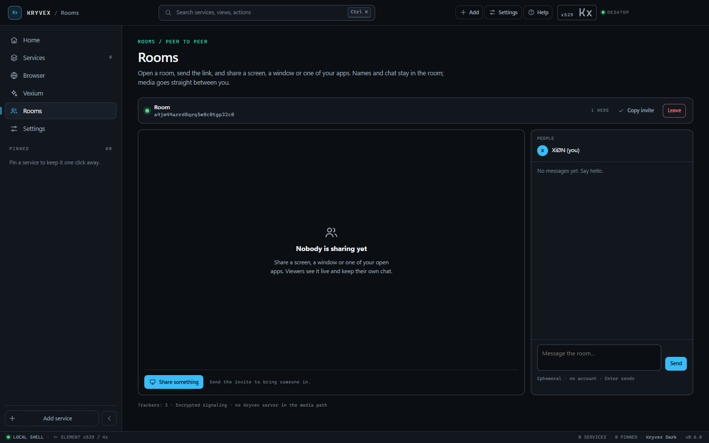

`Ctrl 6` opens Rooms. **Create a room** mints a 26-character code; the invite
copies as `kryvex://room/…`, and anyone who opens it lands in the same room.
Inside, you get a name, a colour, a presence list and ephemeral chat — no
account, nothing listed publicly. **Share something** lists your screens, your
windows and every open Kryvex app, so you can hand over one Discord session
instead of your whole desktop. Peers decode the stream directly; signaling
rides three public WebTorrent trackers, and no Kryvex server sees the media.

The honest limits are in [PARTY.md](docs/PARTY.md): mesh sharing costs the
sharer one upload per viewer, roughly six viewers at 720p on a normal line, and
peers behind strict corporate NATs need a TURN relay you supply. File drop,
voice and co-watch are the next steps, not shipped features.

### Calls — microphone and camera prompt

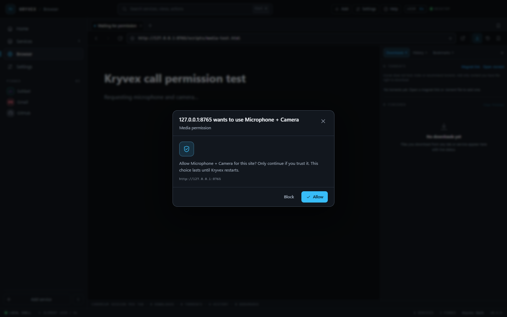

The page asks; Kryvex shows the origin and the exact devices in a shell-owned
modal. **Allow** grants only those devices for that origin until Kryvex
restarts. **Block** returns a normal denial to the page. This is enough for
Discord, WhatsApp, Messenger, Instagram and Telegram web calls without
opening a second browser.

### Default browser setup

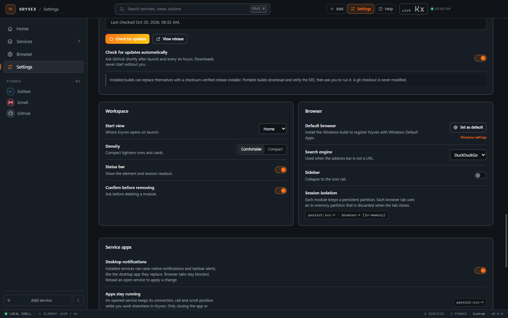

**Settings → Browser** reports the current state and offers **Set as default**.
The installed build registers `http` and `https`, then opens Windows Default
Apps because Windows requires the user's final choice.

### Chromium engine settings

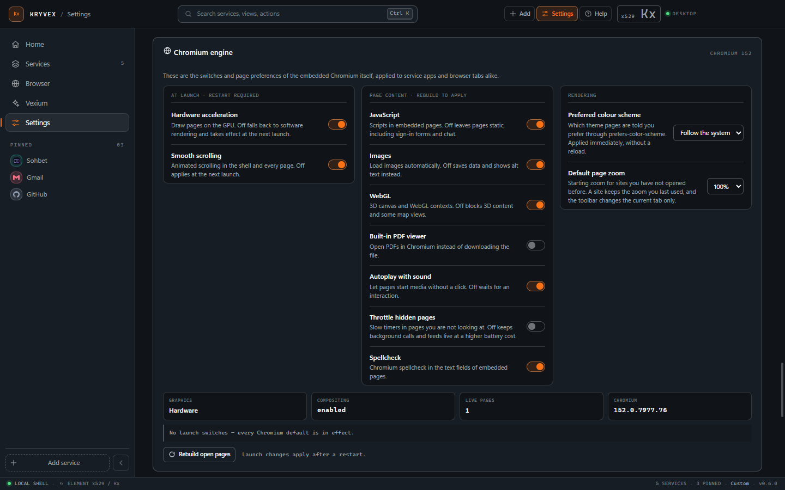

**Settings → Browser → Chromium engine** controls the engine itself instead of
describing it. Hardware acceleration and smooth scrolling are launch switches;
JavaScript, images, WebGL, the PDF viewer, autoplay, hidden-page throttling,
spellcheck and the default zoom are page preferences; the preferred colour
scheme applies immediately. The panel reads the live engine back — Chromium
version, GPU compositing, active launch switches and how many embedded pages
use the profile — and **Rebuild open pages** remounts each guest, because a
Chromium webview keeps the preferences it attached with.

### Command palette

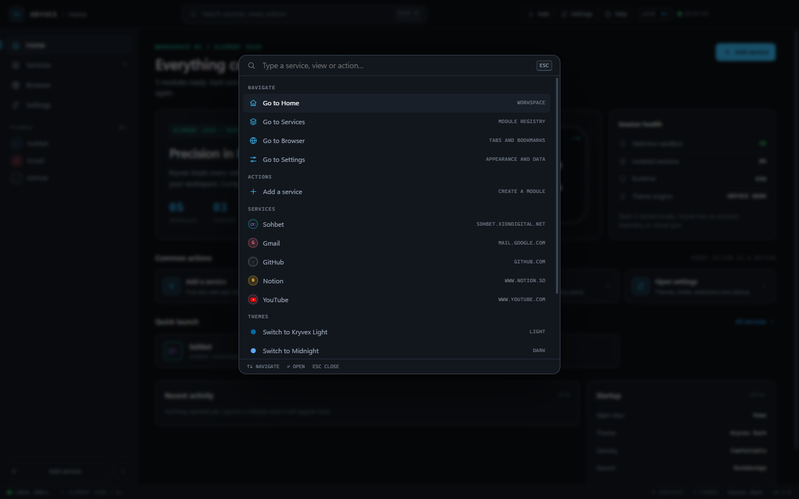

`Ctrl K` reaches anything: views, add-service, every module, and theme
switching — without leaving the keyboard. It is optional: the same actions are
available through the header, Home cards, sidebar and Help dialog.

### Kryvex Shield and extensions

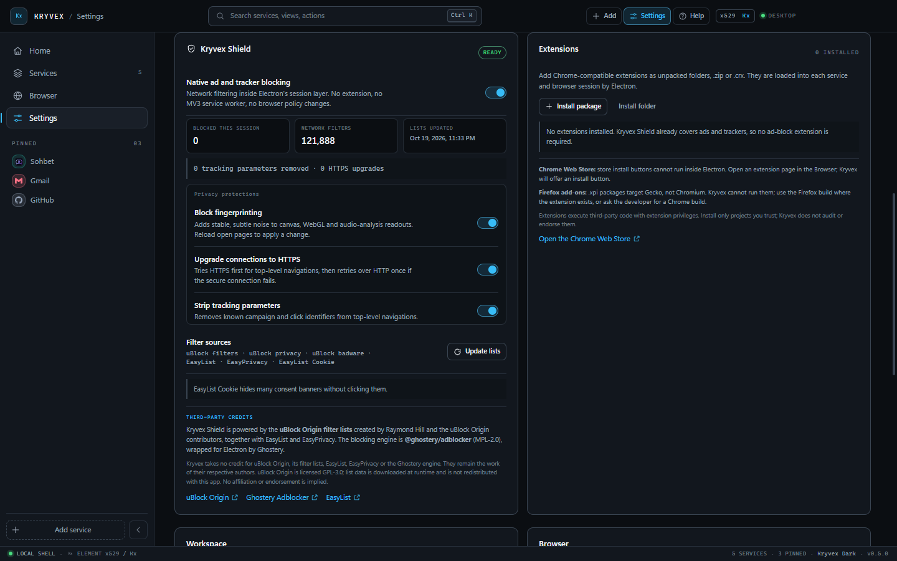

The shield reports its state, filter count, blocked requests this session, list
sources and last update. Next to it, Chrome-compatible extensions can be
installed, toggled or removed. The credit block names uBlock Origin, Ghostery
and EasyList explicitly.

### Wallpaper and creator editions

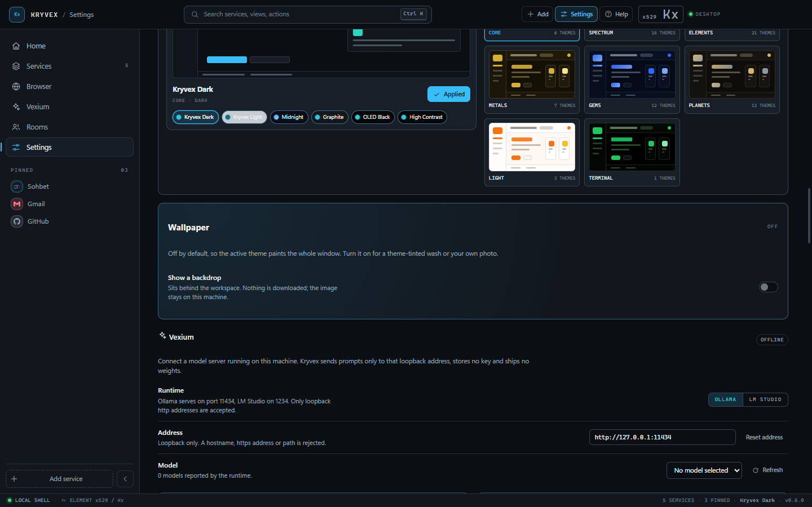

**Settings → Appearance** ends with a wallpaper panel that is off by default:
the active theme paints the whole window until you flip the pill switch. Turn
it on and pick **Theme wash** — a gradient built only from that theme's own
accent tokens, so it moves with every theme you choose — or **My image** to
drop in your own photo with a veil, fill, fit or tile. Kryvex re-encodes the
image to a bounded WebP, keeps it beside the state file on desktop
(localStorage in the web preview) and never writes it into the saved state.
The header, sidebar and status bar turn to frosted glass so the artwork reads
through; panels keep enough body for legible text.

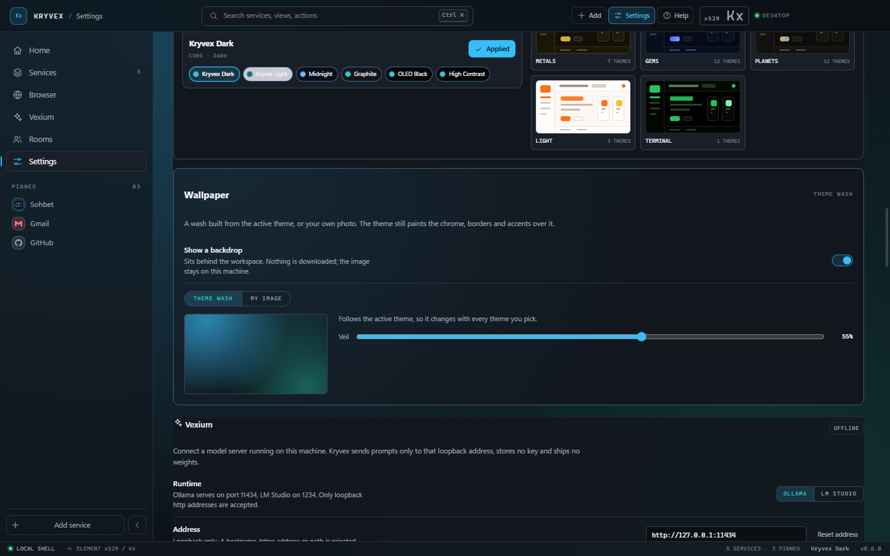

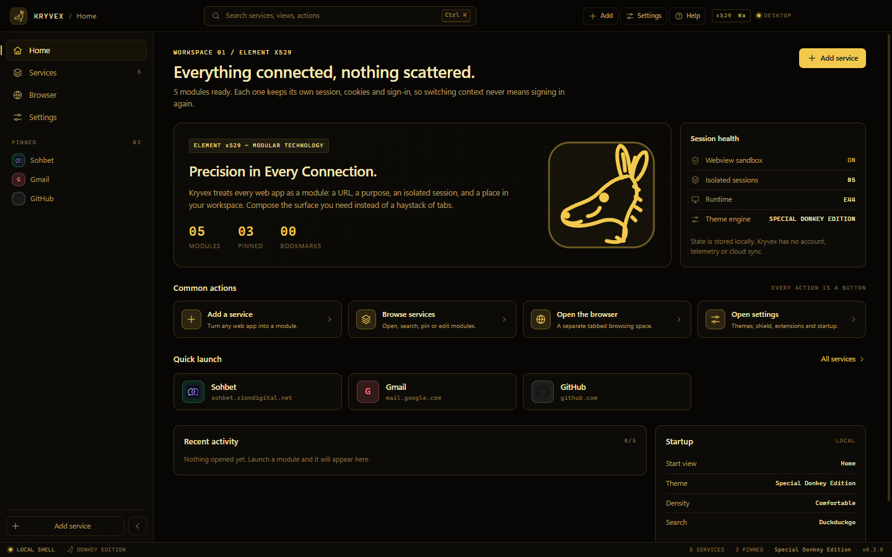

Both creator skins now sit in the same periodic table as the rest of the
catalogue, under **CUSTOM** — one chooser, no duplicate card. **Special Donkey
Edition** is a self-contained plugin: true-black surfaces, gold line work, and a
donkey mark in place of the element tile. It is still a normal token theme, so
every surface, focus ring and chart follows it.

### Updates

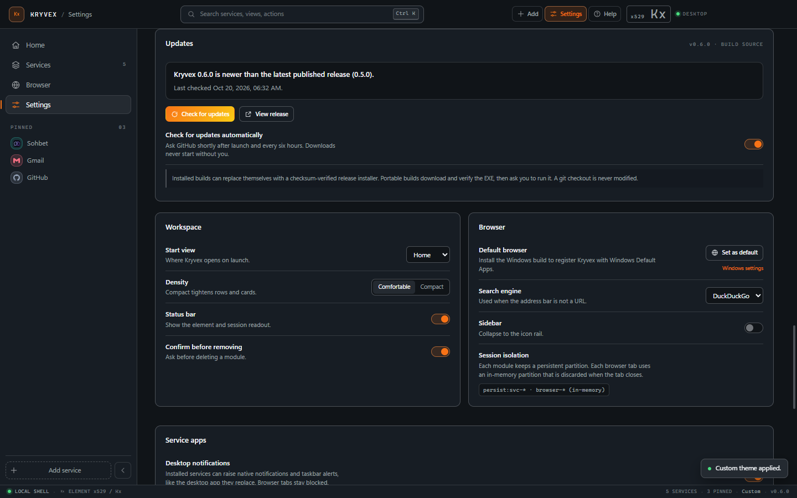

**Settings → Updates** checks this repository's public releases, shows the
running build and explain what each build can do with a new version. Installed
builds download a checksum-verified Setup EXE and can install it on restart;
portable builds reveal the verified EXE for a manual swap; a git checkout just
links to the release. When nothing newer exists the panel says so in green — an
**UP TO DATE** verdict beside the running version — and a manual check confirms
with a toast instead of leaving the panel looking untouched.

### Download location

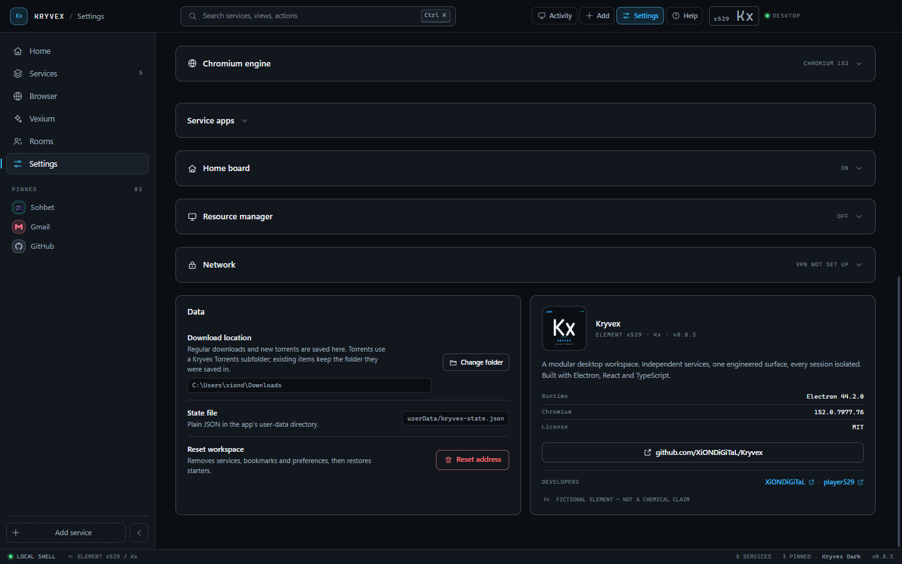

**Settings → Data** shows the folder regular downloads and new torrents use.
**Change folder** opens the native folder picker; **Use the Downloads folder**
returns to the system default. Existing downloads and torrent rows keep the
folder they were saved in.

### Vexium — a local assistant

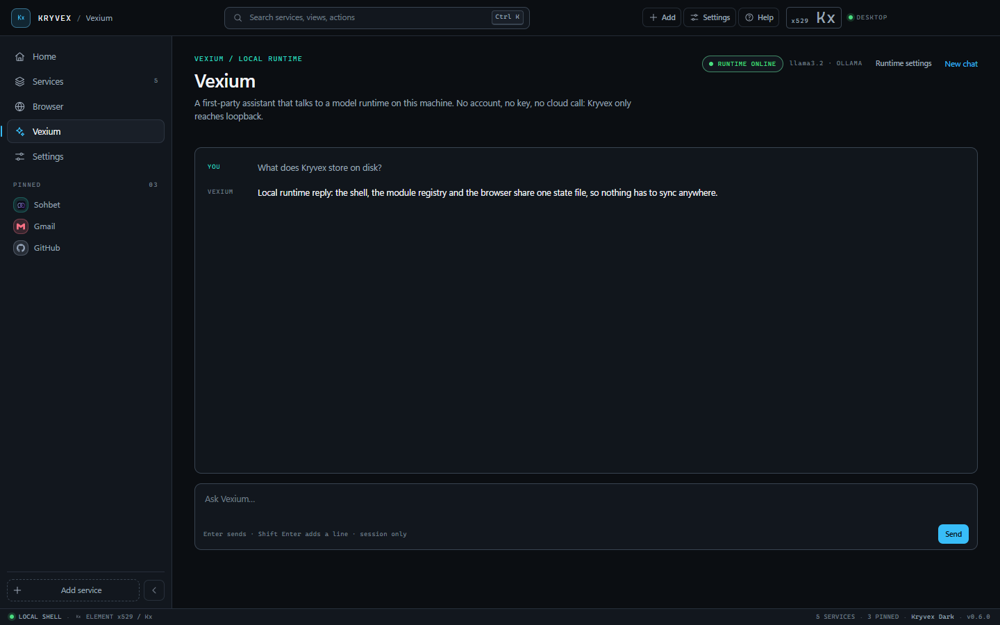

_This capture used a stand-in runtime on loopback because no model server was
installed on the build machine; the protocol is the same one Ollama and LM
Studio speak._

The assistant is a first-class view (`#/assistant`, sidebar, `Ctrl 4`, command
palette, Help). It reads the model list from a runtime on loopback, streams the
reply into the thread and lets you stop mid-answer. Prompts and replies live in
the window only: nothing is written to disk.

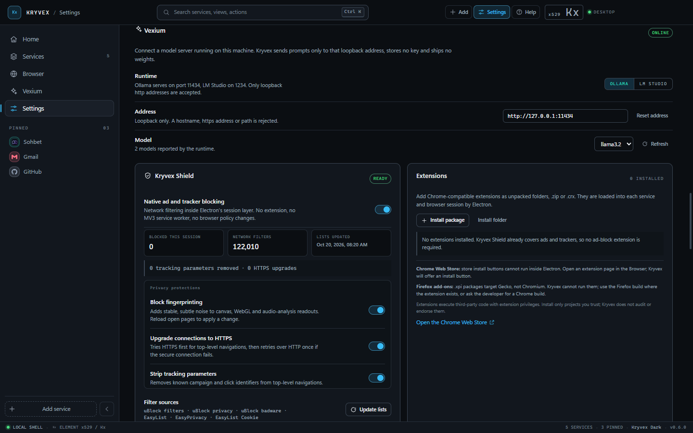

**Settings → Vexium** picks the runtime (Ollama on 11434, LM Studio on 1234),
shows the address it will use and the models the runtime reports. Anything that
is not plain http on `127.0.0.1`, `localhost` or `[::1]` is refused, and the
check happens again in the main process. See [ASSISTANT.md](docs/ASSISTANT.md).

#### Run a model file

No runtime installed? **Settings → Vexium → Run a model file** takes a `.gguf`
file you already downloaded, starts llama.cpp's `llama-server` against it on a
free loopback port, waits until `/v1/models` answers, and points Vexium at it.
**Get models** links to Hugging Face's GGUF catalogue, Ollama's library and LM
Studio's models; Kryvex hosts and redistributes nothing. If `llama-server` is
not on your PATH, **Find runtime…** stores the path to the executable once, and
a `.js` wrapper runs on Electron's own Node. Context size and GPU layers are
adjustable, the runtime's output is kept for errors, and the process is killed
when you press **Stop server** or quit Kryvex.

### Settings and themes

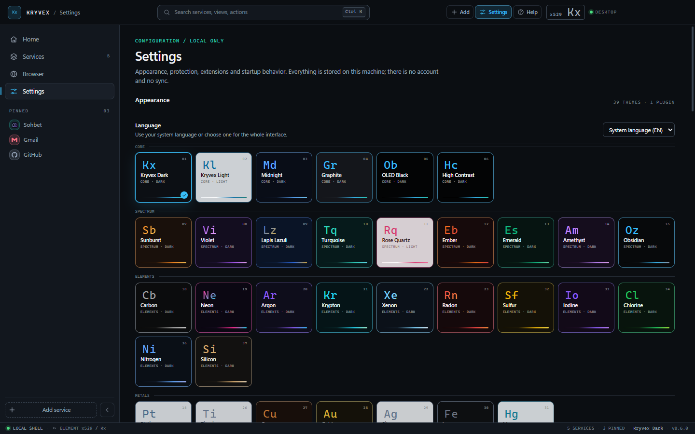

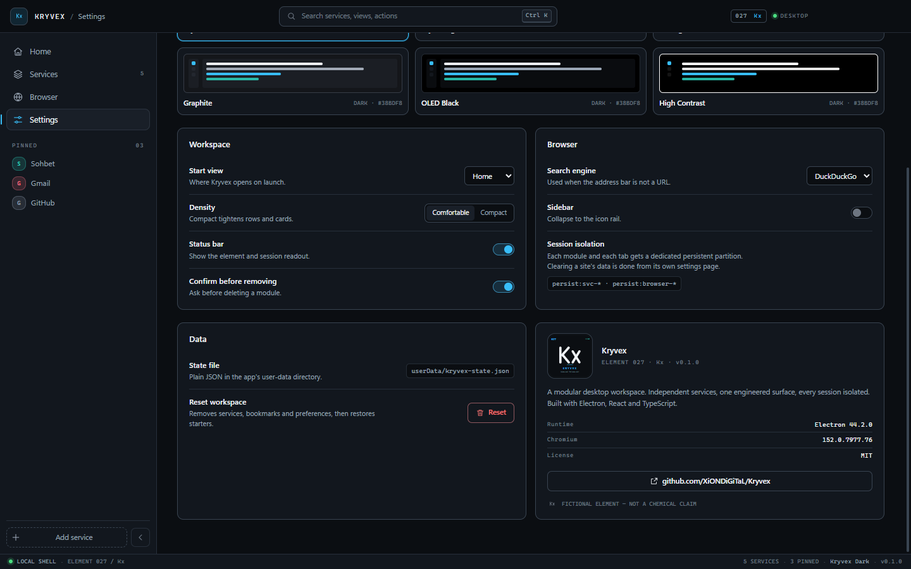

Theme, density, start view, search engine, sidebar behaviour, reset and runtime
details. The picker groups all 80 themes by family, creator plugins included;
**Custom** opens the colour studio and the wallpaper panel sits underneath.

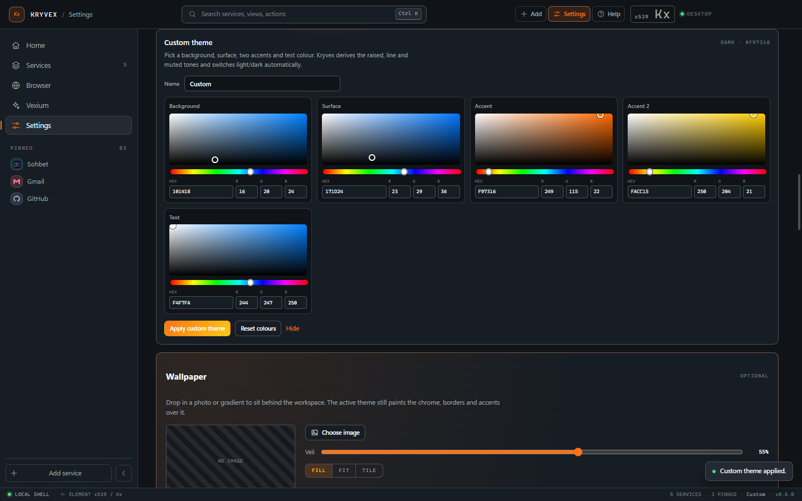

Every colour in the Custom theme has a hue/saturation field, a rainbow slider
and an editable HEX, R, G and B value. Applying it derives the matching line,
raised and muted tones and switches light/dark automatically.

### First look — the theme gallery

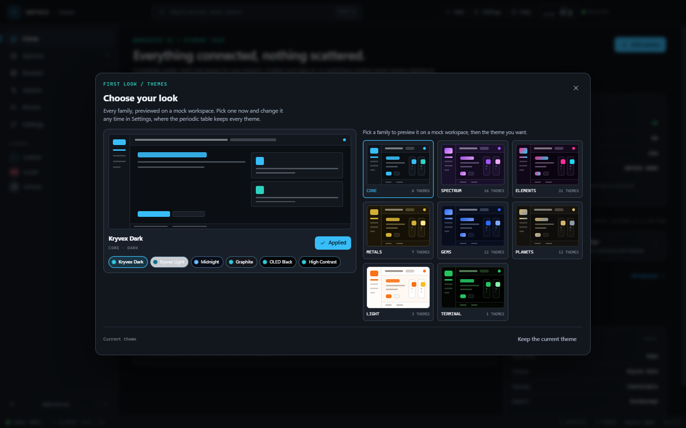

A fresh install opens **Choose your look** over the shell: eight family cards,
each painted on a mock workspace, plus a full-size preview and the family's
themes as chips. Clicking a family only previews it; clicking a theme applies
it and dismisses the sheet. **Keep the current theme**, the close button and
`Esc` all skip the choice, and none of it comes back — the flag is persisted
with the rest of the settings. An upgrade never interrupts: a state file
written before the gallery counts as already seen.

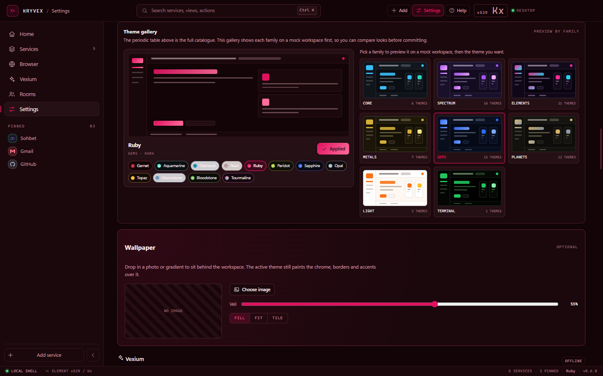

The periodic table is untouched and still first in **Settings → Appearance**.
The gallery sits directly beneath it, so the exhaustive grid stays the default
route and the preview route is one scroll away. The About panel reports the actual Electron/Chromium versions from the
running app, the `x529` element designation, and linked developer credits for
XiONDiGiTaL and player529.

### Light theme

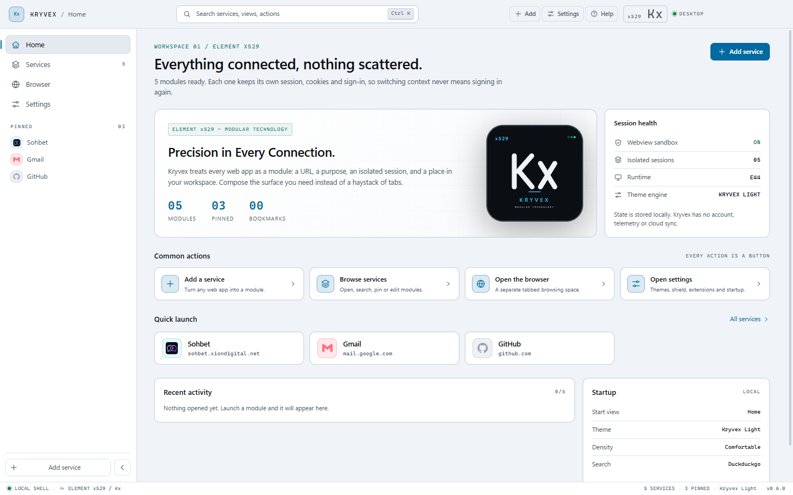

The same tokens, contrast-checked for light surfaces: darker accents, readable
metadata, and the graphite element tile preserved as the brand anchor.

## Adding services

1. Click **Add service** in the header (or the dashed button at the bottom of
   the sidebar), or press `Ctrl K` and choose **Add a service**.
2. Pick a catalogue preset or enter a name, URL, category and colour.
3. Save. Kryvex normalises the URL, assigns a partition
   (`persist:svc-<id>`), adds the module to the registry, and puts it in the
   sidebar if pinned.

```jsonc
// What a module looks like inside kryvex-state.json
{
  "id": "s-2f5c...",              // validated, URL-safe, used for the partition
  "name": "Instagram",
  "url": "https://www.instagram.com",
  "category": "communication",    // communication | productivity | development | media | other
  "color": "#FB7185",             // one of the eight brand-safe accents
  "letter": "I",
  "icon": "instagram",            // optional known-brand glyph
  "pinned": true,
  "createdAt": 1760000000000,
  "lastOpened": 1760000009999
}
```

Modules are data only. A module cannot execute code in the shell, register
hooks, or access another module's session. The registry rejects duplicate IDs,
unsafe IDs, non-http(s) URLs, unknown categories, off-palette colours and
unknown icon keys before anything is written. See [docs/APP.md](docs/APP.md)
for the manifest contract and lifecycle.

### Presets are links, not integrations

The catalogue contains public web endpoints. Instagram, WhatsApp, Telegram and
the rest still run their own code, enforce their own login flows and may refuse
to work inside any embedded browser. Kryvex offers **Open externally** rather
than weakening the session. There is no unofficial API, scraper or credential
collection in this project.

## Kryvex Shield

Kryvex Shield is a native filter engine attached to Electron sessions. It is
enabled by default, downloads its lists once, caches a compiled engine in the
user-data directory, and refreshes after seven days.

- **Filter sources:** uBlock Origin `filters`, `privacy` and `badware` lists,
  plus EasyList, EasyPrivacy and EasyList Cookie.
- **Engine:** `@ghostery/adblocker` with its Electron `webRequest` adapter.
- **Scope:** the shell, every `persist:svc-*` module session, and every
  in-memory `browser-*` tab session.
- **State:** toggle, update-now, filter count, last update and a session
  blocked counter in Settings.
- **No MV3:** no extension service worker, no `declarativeNetRequest`, no
  Chrome Web Store dependency for the shield itself, no manifest permissions.

### My filters

**Settings → Shield → My filters** accepts the syntax users already paste into
uBlock Origin's dashboard: `||ads.example.com^`, `site##.selector`,
`site##+js(…)`. Rules live in the shield's own config, compile on top of the
downloaded lists, and rebuild from a cached copy of those lists — editing a
rule never waits on six downloads, and it works offline.

Three switches decide what runs:

- **Enable my custom filters** — off keeps the text but compiles nothing.
- **Allow scriptlet rules (+js)** — scriptlets run code inside the page, so
  they are held back until this is on; the editor counts what is on hold.
- **YouTube: block ads and feed noise** — a curated bundle that hides ad slots,
  sponsored feed cards and recommendation shelves, switches off YouTube's
  ad-block popup config, and blocks `youtube.com/pagead/`, `doubleclick.net`
  and `googlesyndication.com` on youtube.com only.

**Import and append…** adds a `.txt` list to the editor; **Export…** writes the
current one out. `@ghostery/adblocker` parses scriptlets but ships no scriptlet
library, so Kryvex implements uBO's `set`/`set-constant` itself and injects it
into the page's main world on `dom-ready`. Other scriptlet names are ignored
rather than silently faked.

### Privacy protections inside the shield

- **HTTPS upgrade with fallback:** address-bar and link navigations to a
  public, default-port HTTP URL are rewritten to HTTPS before the request. If
  the secure connection fails, Kryvex allows exactly that destination over
  HTTP once. Loopback, `.local`, `.internal` and RFC 1918 destinations stay on
  HTTP so routers, printers and development servers remain usable.
- **Tracking-parameter stripping:** `utm_*`, `fbclid`, `gclid`, `msclkid`,
  `mc_cid`, `igshid` and a curated set of similar identifiers are removed from
  top-level GET navigations. Same-site navigations are skipped because those
  parameters are often functional.
- **Fingerprint farbling:** `canvas` readback/serialization, WebGL
  `readPixels` and `AnalyserNode` frequency data are perturbed by low-order,
  stable noise seeded from the app session and the site. Repeated reads are
  consistent; a different site sees a different device profile. This is a
  JavaScript-level approximation, not a Chromium patch, and sites can still
  detect that a wrapper exists.
- **Cookie banners:** EasyList Cookie hides many consent notices rather than
  clicking a choice on the user's behalf. Sites that block scrolling behind an
  overlay may still need a manual action.
- **Separate switches:** the three Kryvex-specific protections can be turned
  off independently without disabling ad/tracker filtering. Changes apply to
  newly loaded pages; reload an open page after changing fingerprinting.

### Why not ship the uBlock Origin extension?

uBlock Origin classic is Manifest V2. Electron 44 loads the extension package,
but its blocking `webRequest` layer is inert and its dashboard never finishes
initialising. Shipping it would be a decorative toggle that blocks nothing.
Kryvex uses uBO's **filter lists** natively instead. A local shim lets the
Ghostery Electron adapter share its cosmetic-filter IPC handlers across many
isolated sessions (the upstream adapter assumes one session per process).

Verification: a service partition loaded a page requesting
`facebook.com/tr` and `connect.facebook.net`; with the shield on, the engine
reported 2 blocked requests and those requests failed with
`net::ERR_BLOCKED_BY_CLIENT`. With it off, they completed. A live DevTools
harness also navigated to `https://example.com/?utm_source=kryvex&keep=1`,
observed `https://example.com/?keep=1`; loaded a local HTTP-only host through
`127.0.0.1.nip.io`, where the HTTPS attempt was refused and the navigation
settled on HTTP; compared native and farbled canvas output; and confirmed that
farbling is stable and stops when the toggle is off. The refreshed engine
reports about 121,700 filters including EasyList Cookie.

## Extensions

Settings → Extensions loads Chrome-compatible extensions:

- **Install package:** `.zip` or `.crx` (CRX3 headers are stripped to the ZIP
  payload). **Install folder:** an unpacked extension directory.
- Kryvex copies the extension into `userData/extensions/<key>`, validates
  `manifest.json` and Manifest V2/V3, and loads it with Electron's
  `session.extensions` API.
- Each installed extension can be enabled, disabled or removed. It is loaded
  into existing sessions and attached to new service/browser partitions as they
  appear.
- Tested with a minimal MV3 content-script extension: it loaded in a
  `persist:svc-*` partition and modified the page.

**Chrome Web Store:** the store's own install button cannot run inside
Electron. When a Chrome Web Store detail page is open in the Kryvex browser,
Kryvex shows its own install bar and downloads the CRX directly from Google's
update service, validates it, and loads it into the existing sessions. The
store page is never scraped for arbitrary listings.

**Firefox add-ons:** `.xpi` files target Gecko, not Chromium. Electron cannot
run them, so Kryvex rejects them with a clear message instead of pretending.
Use a Chrome build of the add-on when one exists.

Extensions execute third-party code with extension privileges. Install only
projects you trust. Kryvex does not audit or endorse them.

## Themes

78 catalogue themes live in [`brand/themes.json`](brand/themes.json), the
**Special Donkey Edition** and **Special XiØN Edition** ship as plugins, and
**Custom** is generated from your own colours. The picker arranges them as a
periodic table: every tile carries a two-letter symbol, a family label, its
mode and a palette strip, so the whole collection reads at a glance.

| Family | Themes |
| --- | --- |
| **Core** | Kryvex Dark, Kryvex Light, Midnight, Graphite, OLED Black, High Contrast |
| **Spectrum** | Sunburst, Violet, Lapis Lazuli (deep blue with gold ascents), Turquoise (pale mint), Rose Quartz, Ember, Emerald, Amethyst, Obsidian, and the reds and pinks: Crimson (`#DC143C`), Vermillion, Coral, Rosé, Blush, Magenta, Fuchsia |
| **Elements** | Carbon (near-black charcoal), Neon, Argon, Krypton, Xenon, Radon, Sulfur, Iodine, Chlorine, Nitrogen, Silicon, plus flame-test elements: Strontium, Barium, Potassium, Sodium, Calcium, Cesium, Rubidium, Phosphorus, Zinc, Bismuth |
| **Metals** | Platinum (silver with an aero glass sheen), Titanium, Copper, Gold, Silver, Iron, Quicksilver |
| **Gems** | Birthstones and stones: Garnet, Aquamarine, Diamond, Pearl, Ruby, Peridot, Sapphire, Opal, Topaz, Moonstone, Bloodstone, Tourmaline |
| **Planets** | Mercury (stone grey), Venus (cream), Earth (ocean blue/green), Mars (rust), Jupiter (banded cream with a red spot accent), Saturn (pale gold and ring silver), Uranus (eerie icy teal), Neptune (vibrant blue), Pluto (white with brown-red), Nibiru (near-black with a faint dark red), Sun (solar gold/orange), Moon (silver) |
| **Lights** | Helium, Lithium, Oxygen |
| **Terminal** | Terminal — pitch black with high-contrast phosphor green in the mono face |
| **Plugin** | Special Donkey Edition — true black, gold outlines, donkey mark. Special XiØN Edition — near-black glass, one electric blue (`#33B5E5`), the XiØN blade mark, a soft glow and liquid progress fills. |
| **Custom** | Five colour pickers (background, surface, accent, accent two, text) with a hue/saturation field, rainbow slider, HEX field and editable R/G/B channels; raised, line and muted tones are mixed automatically. |

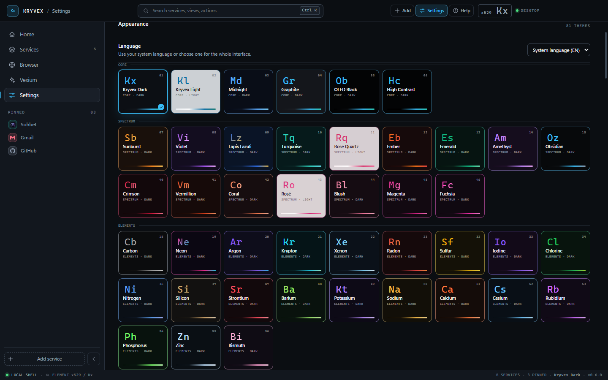

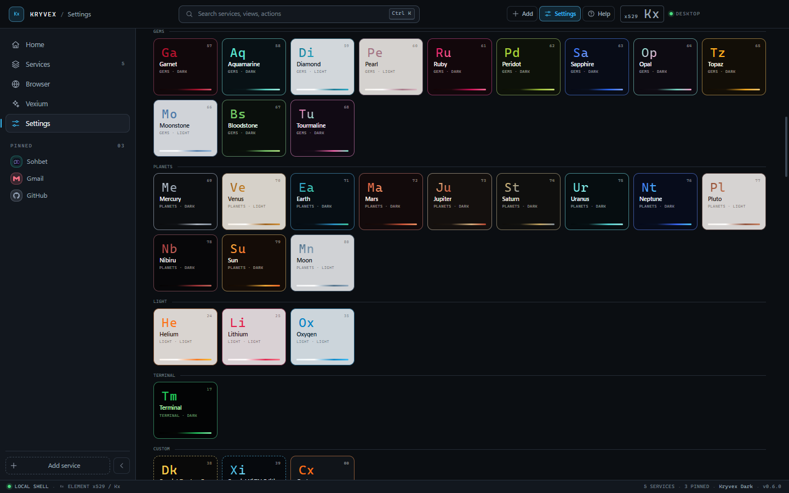

The **planets** band is built from blended bodies rather than flat accents:
Jupiter pairs banded cream with a Great Red Spot red, Uranus is a pale eerie
ice teal, Neptune runs two vibrant blues over navy, Pluto is white with a
brown-red accent and Nibiru is near-black with a deliberately faint dark red.

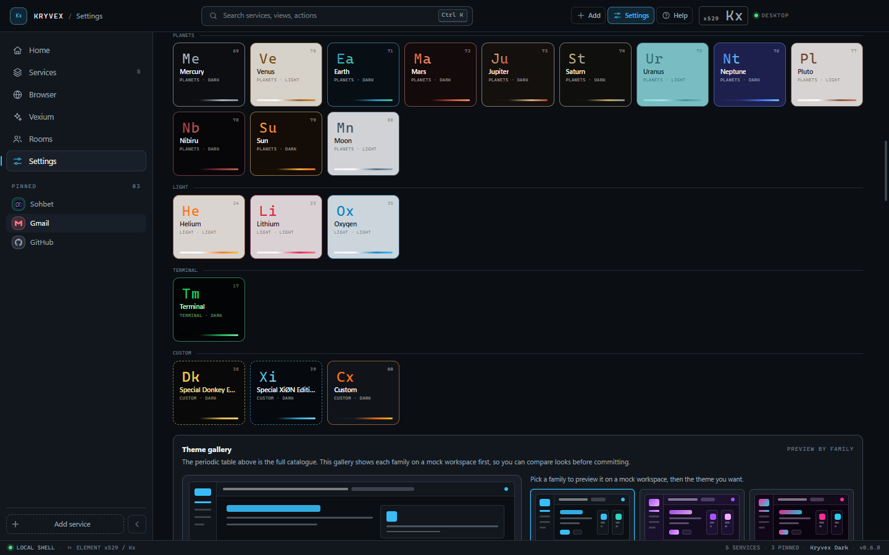

Gradient themes paint buttons, marks, active outlines and the tile strip with
an accent-to-accent gradient; glass themes add a reflected sheen to chrome
surfaces; the terminal theme swaps the interface to the mono face.

**Special XiØN Edition** is the full-power skin: the darkest base in the
catalogue, a single electric blue, a slow glow on the blade mark and brand chip,
and progress fills that carry a travelling Windows-style liquid highlight. Glow
and liquid motion are opt-in CSS behind `data-theme="special-xion"` and stop
under `prefers-reduced-motion`.

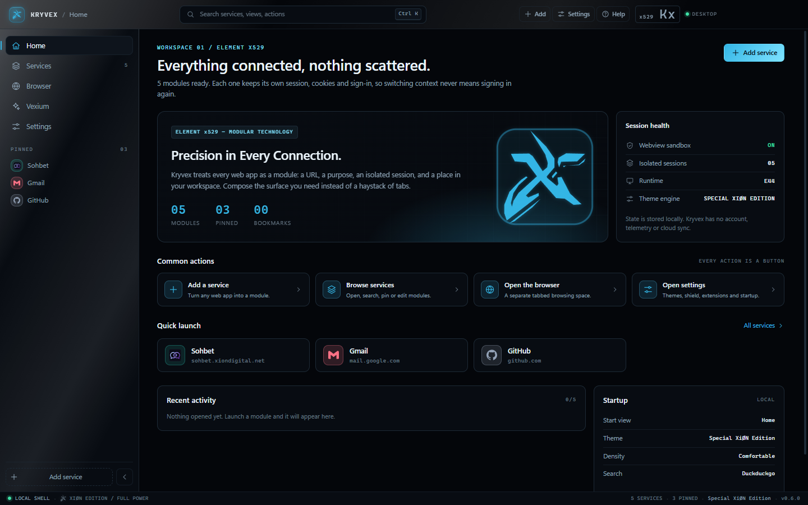

The blade mark replaces the element tile in the header, hero and status bar;
their tiles keep their own brand colour in the table, so the donkey stays gold
and XiØN stays blue whatever theme is active. Both are picked like any other
theme: click the tile, no separate activation card.

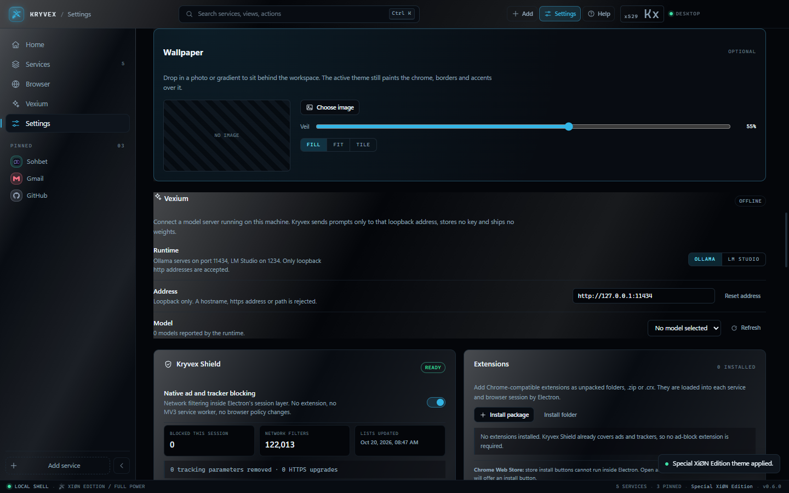

[`brand/tokens.json`](brand/tokens.json) is the single source of truth for
colour, spacing, radii, typography, motion and shell metrics. Themes apply CSS
custom properties at runtime; there is no second palette to drift.

### Writing a theme plugin

`src/plugins/donkey.tsx` and `src/plugins/xion.tsx` are the reference
implementations: a theme object with
`plugin: true`, a `mark` hint, and any marks the theme wants. Register it in
`src/plugins/index.ts`; the theme grid, command palette and persistence pick it
up automatically. Plugin themes are validated by the same `isThemeId` path as
core themes, so a bad import cannot poison saved state.

## Architecture

Kryvex is a purpose-built implementation (no third-party desktop workspace is
vendored or rebranded) built around a small trusted main process and untrusted
content:

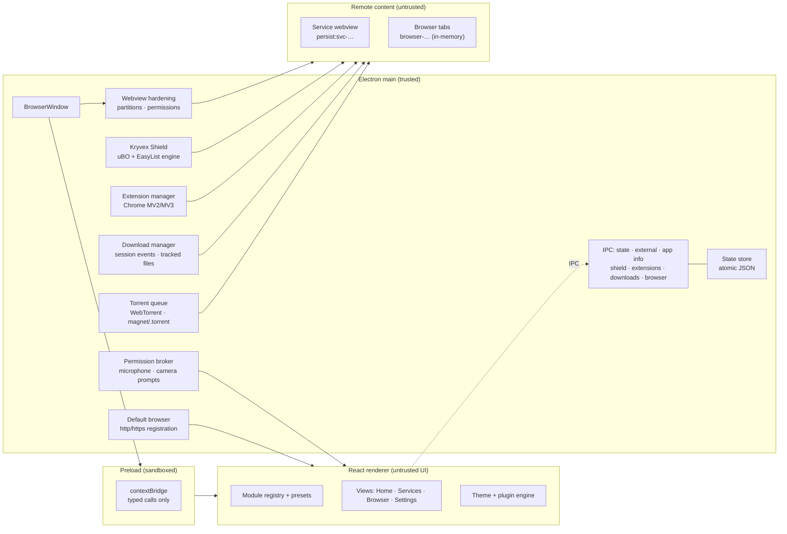

- **Main** owns the window, state file, filter engine, extension folders and
  every security decision.
- **Preload** exposes typed calls only — state, external links, app info,
  shield status/control, extension list/install/toggle/remove, download and
  torrent records/actions, permission responses, and browser registration/URL
  handoff. No filesystem, shell, arbitrary IPC or extension path crosses the
  bridge.
- **Renderer** owns UI and validation. It has no filesystem or shell access.
- **Remote content** runs in hardened webviews: no preload, no Node, sandboxed,
  isolated partitions, http(s)-only navigation, auth popups allowed only from
  service sessions and background pop-unders denied, and permissions denied except clipboard writes, fullscreen and the
  explicit microphone/camera prompt.

### Project structure

```text
electron/
  main.ts              window, state store, capture routine, IPC registration
  preload.ts           contextBridge API
  shield.ts            native uBO/EasyList engine, cache, session attachment
  brave-rules.ts       tracking-parameter and HTTPS upgrade rules
  web-privacy.ts       combined webRequest pipeline, HTTPS fallback, seeds
  farbling-preload.ts  per-site canvas/WebGL/audio farbling in the main world
  extensions.ts        Chrome package installer + per-session loader
  downloads.ts         Chromium download tracker
  torrents.ts          WebTorrent queue, safe folders, live stats
  torrent-rules.ts     magnet validation, names, peer/protocol helpers
  party.ts             Rooms capture broker: source list, shell-only display-media grant
  permissions.ts       microphone/camera prompt broker and per-origin grants
  hardening.ts         privacy switches + per-session permission/request policy
  privacy.ts           pure referrer, GPC and partition rules
  types.ts             main-process IPC payload types
src/
  App.tsx              shell, routing, state, palette, dialogs, toasts
  components/          shell chrome, service dialog, palette, webview, UI
  views/               Home, Services, ServiceStage, Browser, Settings
  lib/                 store, services, catalogue, brand icons, themes, storage
  plugins/             Special Donkey Edition theme + mark
  styles.css           all UI styling, token-driven
brand/                 logo + variants, icons, tokens.json, themes.json
docs/                  architecture, security, attribution, testing, banner
tests/                 unit tests (vitest)
screenshots/           captures produced by the running app
scripts/               dev + capture helpers
```

## Getting started

**Requirements:** Node 24+, pnpm 12+, Windows 10/11 for the packaged app.
Verified with Node 24.19.0, pnpm 12.3.4, Electron 44.2.0.

```bash
# 1. install (downloads the Electron runtime)
pnpm install

# 2. develop with hot reload — starts Vite and the Electron shell
pnpm dev:electron

# web-only preview of the UI (no webviews)
pnpm dev

# 3. verify
pnpm typecheck     # renderer + main, strict
pnpm test          # 219 unit tests

# 4. production build
pnpm build         # dist/ (renderer) + dist-electron/ (main + preload)
pnpm start         # run the built app
```

### Scripts

| Script | Purpose |
| --- | --- |
| `pnpm dev` | Vite dev server for the renderer (`http://127.0.0.1:5173`). Webviews show a fallback panel. |
| `pnpm dev:electron` | Vite + Electron with hot reload. |
| `pnpm build` | Renderer bundle + compiled main/preload. |
| `pnpm start` | Launch the built app. |
| `pnpm typecheck` | `tsc --noEmit` for both projects. |
| `pnpm test` | Vitest unit suite. |
| `pnpm capture` | Rebuild and regenerate `screenshots/` from the running app in a disposable profile. |
| `pnpm verify:restart` | Close/relaunch the built app and check theme, start view and saved tabs. |
| `pnpm verify:downloads` | Persist a real download in a chosen folder, reload the manager and delete the restored file. |
| `pnpm verify:location-ui` | Launch the built app, check the download-location row and reset it to the real Downloads folder. |
| `pnpm verify:torrents` | Persist a .torrent and magnet across a location change, restore them paused in a fresh manager, then resume and delete both. |
| `pnpm verify:torrent-restore-ui` | Launch the built app with a seeded queue and check the restored paused row and Resume action in Downloads. |
| `pnpm verify:browser` | Drive find-in-page and page zoom through the real toolbar. |
| `pnpm verify:updater` | Run the real app against a local release feed: available, bad checksum, ready, source-mode and missing-release paths. |
| `pnpm run package:dir` | electron-builder unpacked Windows directory (`release/win-unpacked`). |
| `pnpm run package:win` | electron-builder installer/portable targets (unsigned). |
| `pnpm release:checksums` | Write `release/SHA256SUMS.txt` for the Setup and Portable EXEs. |

`pnpm pack` is pnpm's own tarball command, not the packaging script — use
`pnpm run package:*`.

### Packaging

`package.json` contains the electron-builder configuration: app id
`net.xiondigital.kryvex`, NSIS + portable Windows targets, the 7-resolution
`brand/icons/kryvex.ico`, extra icons in resources, and production node modules
for the shield/extension runtime. Code signing is not configured, so current
builds are unsigned development artifacts.

`pnpm run package:win` writes distinct artifacts: a standard Setup EXE with a
selectable install folder, Desktop/Start Menu shortcuts and an uninstaller; and
a Portable EXE for no-install use. The unpacked build remains at
`release/win-unpacked/` (not committed). All artifacts stay out of Git via
`.gitignore`.

## Data and privacy

- State lives in Electron's `userData` directory as `kryvex-state.json`; the
  web preview uses `localStorage` instead.
- Writes are debounced (250 ms), capped at 1 MB, and atomic (temp file +
  rename). A corrupt or hostile state file is sanitised, never trusted.
- Shield configuration lives in `kryvex-shield.json`; the compiled engine is
  `kryvex-shield-engine.bin` (about 6 MB). Both stay on this machine.
- Installed extensions live in `userData/extensions/<key>` with metadata in
  `kryvex-extensions.json`.
- Browser tabs do not write cookies or storage to disk; their in-memory
  partitions are cleared when the tab closes.
- The download folder is stored in `userData/kryvex-storage.json`; the default
  is the Windows Downloads folder. Regular downloads use it directly and new
  torrents use its `Kryvex Torrents` subfolder. Previously used roots are
  retained so existing files can still be opened or deleted after a change.
- Torrent queue rows are stored in `userData/kryvex-torrents.json`; `.torrent`
  metadata is copied to `userData/kryvex-torrent-metadata/`. A restart restores
  the rows as paused, with no client or transfer running. Kryvex does not open
  router ports (UPnP/PMP are off).
- Microphone and camera grants are per origin and in memory; closing Kryvex
  forgets them. No grant is persisted to `kryvex-state.json`.
- Kryvex has no backend, account system, telemetry or remote config. Network
  traffic is only what your own modules load, plus the first-run/7-day filter
  list download from `ublockorigin.github.io`, `easylist.to` and
  `secure.fanboy.co.nz`, and any torrent peers or trackers you choose to use.
  Web Store installs contact `clients2.google.com` and
  `clients2.googleusercontent.com` only when the user presses the install bar.
- HTTP fallback records and fingerprint seeds are in memory only. They are
  discarded when Kryvex exits; no browsing URL is added to `kryvex-state.json`
  by the privacy rules.
- `openExternal` and popup handling accept http(s) only.
- Unknown service favicons are requested from the service's own origin, not a
  favicon CDN.

## Security model

| Control | Implementation |
| --- | --- |
| Renderer isolation | `contextIsolation: true`, `nodeIntegration: false`, `sandbox: true` |
| Bridge surface | Fixed typed IPC calls; shell-sender checks on every read and mutation |
| Remote content | Webviews attach without preload; Node, web security and insecure content forced off |
| Sessions | Allowlist: persistent `persist:svc-*`, disposable `browser-*`; enforced in `will-attach-webview`; a service is mounted once and kept alive until cleared, removed or evicted |
| Notifications | Native notifications only for a recorded service partition while the setting is on; browser tabs denied |
| Sign-in popups | Service `window.open` → sandboxed child on the same session; browser pop-unders denied; everything else external |
| Navigation | Non-http(s) URLs blocked in webviews; shell cannot navigate away from the app |
| Popups | Denied in-app, forwarded to the system browser after protocol validation |
| Permissions | All denied except `clipboard-sanitized-write` and `fullscreen`; USB/HID/Serial and Bluetooth denied |
| Privacy headers | `Sec-GPC: 1`; cross-origin `Referer` trimmed to scheme/host/port; `X-Client-Data` removed |
| URL privacy | Top-level GET navigations are upgraded to HTTPS; a failed upgrade gets one HTTP retry for that URL. Known tracking parameters are removed before the request; loopback and private hosts are exempt. |
| Fingerprinting | A sandboxed frame preload patches canvas, WebGL and audio-analysis readouts inside remote pages only; seeds are per app launch and site. |
| Chromium switches | `no-pings`, `dns-prefetch-disable`, `disable-domain-reliability`, WebRTC public-interface policy |
| Shield | Local lists only, no remote rules at request time, no TLS bypass |
| Extensions | Copied under `userData/extensions`; manifest and size validated; removal is path-checked |
| State | Structural validation, 1 MB cap, atomic write, sanitisation on load |

Known gaps are listed below rather than hidden. See
[docs/SECURITY_MODEL.md](docs/SECURITY_MODEL.md) and
[docs/ATTRIBUTION.md](docs/ATTRIBUTION.md).

## Credits

Kryvex is designed and built by [XiONDiGiTaL](https://github.com/XiONDiGiTaL)
and [player529](https://github.com/player529).

Kryvex takes **no credit** for the following work:

- **uBlock Origin** — filter lists by Raymond Hill and contributors
  ([gorhill/uBlock](https://github.com/gorhill/uBlock), GPL-3.0). Kryvex
  downloads the lists at runtime and does not ship uBO code or claim
  affiliation.
- **WebTorrent** — the embedded BitTorrent client
  ([webtorrent/webtorrent](https://github.com/webtorrent/webtorrent), MIT).
  qBittorrent was used only as a feature reference for peer/speed terminology;
  no qBittorrent code is included.
- **Brave Browser / Brave Core** — feature reference for HTTPS upgrades,
  tracking-parameter stripping, farbling and consent-banner filtering
  ([brave/brave-browser](https://github.com/brave/brave-browser),
  [brave/brave-core](https://github.com/brave/brave-core), MPL-2.0). No Brave
  source code is copied; Kryvex implements small Electron-native equivalents.
- **Ghostery Adblocker** — the filtering engine
  ([ghostery/adblocker](https://github.com/ghostery/adblocker), MPL-2.0).
- **EasyList / EasyPrivacy / EasyList Cookie** — list maintainers
  ([easylist.to](https://easylist.to/), GPL-3.0).
- **Simple Icons** — CC0 brand glyph paths
  ([simpleicons.org](https://simpleicons.org)); trademarks belong to their
  owners and identify the linked services only.

The full license and modification notes are in
[docs/ATTRIBUTION.md](docs/ATTRIBUTION.md).

## Known limitations

- **Windows first.** The app runs on Electron and should work on macOS/Linux,
  but only Windows has been exercised here; packaging is Windows-only.
- **Unsigned installer.** `pnpm run package:win` produces Setup and Portable
  EXEs; code signing is still roadmap work. Updates verify SHA-256 against the
  release's own checksum list, which does not prove the publisher's identity.
- **No delta updates or beta channel.** Each update downloads the full
  installer from the latest stable release; rollback is a manual reinstall.
  Portable and git builds never self-replace.
- **Shield is list-based network filtering.** It is not the full uBlock Origin
  extension: no per-site dynamic rules, no uBO element picker, and cosmetic
  filtering plus the **My filters** box depend on the upstream engine. Only
  uBO's `set`/`set-constant` scriptlet is implemented; other scriptlet names in
  a pasted list are ignored. uBO classic's MV2 network layer does not work in
  Electron 44, which is why this is native.
- **Fingerprinting protection is JavaScript-level.** Canvas, WebGL and audio
  farbling run as a preload wrapper, not a Chromium patch. It raises the cost of
  naive fingerprinting and is deliberately stable per site, but a determined
  page can detect that the APIs are wrapped. Native engine work would be
  required for Brave-level guarantees.
- **HTTPS upgrades cover top-level navigations.** Subresource upgrades,
  interstitial warnings and a full mixed-content policy are not implemented.
  The one-time HTTP fallback is silent; legacy sites are not blocked outright.
- **Cookie-banner filtering is best-effort.** EasyList Cookie hides many
  notices, but overlays that require interaction or block scrolling can still
  need a manual choice. Kryvex never clicks a consent choice for you.
- **Chrome extensions only.** Firefox `.xpi` add-ons cannot run. The Chrome
  Web Store's own install button cannot run inside Electron; Kryvex shows its
  own install bar on detail pages instead. Extensions are third-party code and
  are not audited.
- **Google sign-in inside a module is best-effort, not guaranteed.** Google
  refuses its sign-in page in app-embedded browsers by policy, and no app can
  promise otherwise. Kryvex now presents one consistent Chrome identity: a
  Chrome user agent, `Sec-CH-UA` / `Sec-CH-UA-Mobile` / `Sec-CH-UA-Platform`
  headers (Electron sends none) and a matching `navigator.userAgentData`,
  which Electron omits entirely. On 2026-10-20 that identity reached Google's
  sign-in form from inside a Kryvex guest instead of the refusal card. A stale
  stored Google session is a separate failure — the refusal banner offers
  **Reset session & retry**. If Google still refuses after that, the limit is
  Google's, and **Open in my browser** is the route. Brave is a Chromium fork
  rather than an embedded view, which is why it behaves differently.
- **Parked service pages stay live, but Chromium still decides.** Every opened
  module stays mounted and hidden, and guest throttling is off by default so a
  chat client keeps its heartbeat. The Settings → Chromium switch still wins: if
  you turn background throttling back on for battery, a parked Discord may show
  "connecting" when you return. Press reload in the module toolbar to recover.
- **Browser is intentionally lean.** Downloads, torrents, history navigation,
  a browser library, bookmarks, find-in-page, page zoom and a download-location
  picker are implemented; there is no dedicated extension-manager store page
  yet. Store detail pages expose the Kryvex install bar.
- **Torrents restore, but only transfer on Resume.** The queue is restored
  paused, so nothing continues in the background after a restart. There is no
  bandwidth scheduler, ratio limit, per-file selection or sequential download
  toggle, and router port mapping is off. These are deliberate limits for the
  first release, not hidden features.
- **Calls need a device and a site that allows embedding.** Microphone/camera
  access works, but a service can still refuse to run inside any webview. Use
  **Open externally** when a site blocks embedded calls; Kryvex does not
  weaken its security policy to force it.
- **Default browser needs Windows confirmation.** The installed app registers
  `http`/`https` and Default Apps capabilities, then opens Windows Default Apps;
  Windows 10/11 does not allow an app to silently make itself the default.
  Registration is Windows-only.
- **Theme Studio is roadmap.** Themes are built-in/plugin-based; importing and
  exporting arbitrary themes is not implemented.
- **No sync.** State is local to the machine. There is no account, backup or
  multi-device sync.
- **Brand naming is provisional.** "Kryvex" is a working name; formal name
  clearance has not been completed.

## Roadmap

- Shield depth: per-site exceptions, custom filters, cosmetic-filter
  verification, a blocked-request inspector and an optional native-engine
  experiment for stronger fingerprint resistance.
- Extension UX: drag-and-drop install, update checks and clearer MV2/MV3
  compatibility warnings.
- Theme Studio: custom accent, radius, density and import/export with schema
  validation.
- Hibernation: suspend idle modules to reclaim memory, with explicit states.
- Browser depth: per-site zoom memory and history privacy controls.
- Torrent depth: restore the queue after restart, bandwidth scheduling, ratio
  limits, per-file selection and a sequential-download switch.
- Packaging: signed Windows builds and a CI matrix.
- macOS/Linux validation and platform icon sets.

## License

Code and brand assets are released under the [MIT License](LICENSE).
Kryvex is an independent project; "element x529 / Kx" is a fictional brand
device, not a claim about a chemical element. Third-party data and libraries
retain their own licenses — see [docs/ATTRIBUTION.md](docs/ATTRIBUTION.md).

<div align="center"><sub>KRYVEX · ELEMENT x529 · SHIELD · EXTENSIONS · DONKEY EDITION.</sub></div>
